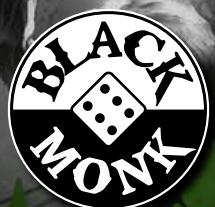
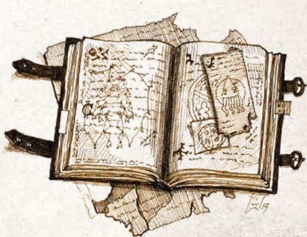
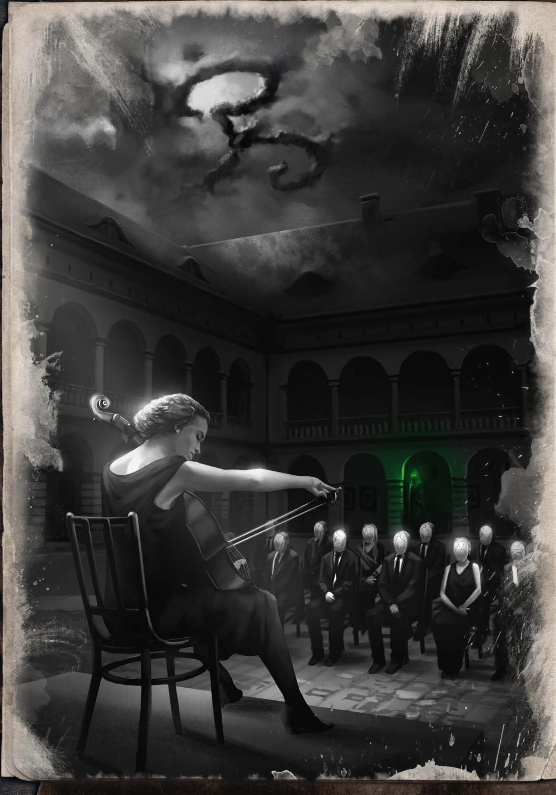

# 版权与目录

> 原文页码 1–176 · 共 8 节

## 本节结构
- ZEW CTHULAU KWIAT PAPROCI
- TWÓRCY
- AUTORSTWO
- ROZDZIAŁ I
- ROZDZIAŁ 2
- ROZDZIAŁ 3
- AUTORZY
- LEGENDA OZNACZENIA SCENARIUSZY

---

# ZEW CTHULAU KWIAT PAPROCI

Zbiór scenariuszy
Chojnacki, Daukszewicz, Jurgiel,
Menio, Pietrzak, Wachciński

# ZBIÓR SCENARIUSZY DO ZEWU CTHULHU

# TWÓRCY

Najkrótsza noc
Autorzy: Piotr Chojnacki i Łukasz Wachciński

Wianki na wodzie
Autorki: Ola Menio i Martyna Pietrzak

Kwiat Paproci AR
Autorzy: Aleksander Daukszewicz i Paweł Jurgiel

Wydawca
Michał Lisowski

Pomysłodawca projektu scenariuszy 1 na 1
Kuba Polkowski

Koordynatorka projektu
Daria Pilarczyk

Redaktor naczelny
Adam Wieczorek

Redaktor pomocniczy
Paweł Marszałek

Korekta
Kasia Wieczorek

Ilustracje
Jakub Fajtanowski i Anna Jarmołowska-Goryńska

Projekt okładki
Marcin Bieliński i Monika Rajkowska-Fuczkiewicz

Skład i opracowanie graficzne
Monika Rajkowska-Fuczkiewicz i Marcin Bieliński

Wykonanie pomocy audio i wideo do scenariusza
Kwiat Paproci AR
Emil Smardzewski i Zbigniew „Zed” Zych

Głosów użyczyli
Anna Kamińska i Grzegorz Daukszewicz

Pomoce dla graczy
Monika Rajkowska-Fuczkiewicz

## AUTORSTWO

Niniejsze dzieło jest fikcją. Nazwy postaci, miejsc oraz wydarzeń mogą stanowić punkt odniesienia, natomiast jakiekolwiek podobieństwo postaci z gry lub scenariuszy do osób żyjących lub zmarłych jest przypadkowe.

Całość opracowania jest fikcyjna i opisywana przez pryzmat mitów Cthulhu bez zamiaru urażenia jakichkolwiek osób żyjących lub zmarłych. Wykorzystanie materiałów z niniejszej książki do celów komercyjnych poprzez wykorzystanie nośników fotograficznych, elektronicznych bądź innych nośników odtwórczych jest zabronione.

Prawa dotyczące mitów Cthulhu mogą być trudne do ustalenia, a część znajduje się w domenie publicznej. W przypadku jakichkolwiek wątpliwości prosimy o kontakt mythos@chaosium.com.

CALL OF CTHULHU, ZEW CTHULHU, Kwiat Paproci © 2020 Chaosium Inc.; wszystkie prawazastrzeżone. „Chaosium Inc.”, Znak Starszych Bogów (Chaosium Arcane Symbol), „Pulp Cthulhu” oraz „Call of Cthulhu” są zarejestrowanymi znakami towarowymi Chaosium Inc. i są używane na licencji. Nazwy, opisy i wszystkie formy przedstawienia świata zastosowane w tym podręczniku wywodzą się z dzieł chronionych prawami autorskimi i znakami towarowymi należącymi do Chaosium Inc. i nie mogą być wykorzystane lub używane powtórnie bez zgody Chaosium Inc. Wszelkie podobieństwo do prawdziwych postaci jest niezamierzone.

Adres do korespondencji:
Black Monk Michał Lisowski
ul. Słowackiego 13/211
60-822 Poznań
kontakt@blackmonk.pl

## ROZDZIAŁ I

NAJKRÓTSZA NOC 3
Jak to się zaczęło?......4
Opis głównych bohaterów......5
Grzegorz Łuszczak
- Bezdomny/Przyjaciel z dzieciństwa......5
Wit Grzesiak - Starszy brat głównej bohaterki......5
Eryk Zann
- Kamerdyner/Marionetka Nienazywalnego......5
Leopold Grzesiak – Ojciec Alicji......5
Wprowadzenie Badaczki......6
Przybycie do domu......6
Odczytanie testamentu......6
Opisy miejsc, wizji i wspomnień......6
Sala balowa......7
Kuchnia......7
Obserwatorium na strychu......7
Sypialnie......9
Biblioteka/czytelnia......9
Piwnica......9
Inne przykładowe wizje......9
Scena finalowa - koncert......10
Mechanika koncertu......10
Statystyki Badaczki......11
Pomoc dla gracza......12

## ROZDZIAŁ 2

WIANKI NA WODZIE 13
Tło przygody....14
Puszczanie wianków i Kwiat Jednej Nocy w Głębicy....15
Rodzinna tajemnica....15
Przed sesją....15
Sceny....15
Scena otwarcia: puszczanie wianków....15
Powrót do domu babci Badaczki....16
Poszukiwania Kwiatu....17
Próba Pierwsza: Łódź....17
Jeśli próba się nie powiedzie....18
Próba Druga: Ciernie....18
Próba Trzecia: Kwiat....18
Próba ucieczki....18
Procesja....18
Rytual....19
Ostatnie życzenie....20
Zakończenia....20
Śmierć ukochanego....20
Szaleństwo w lesie....20
Rytual....20

Po wszystkim....20
Bohaterowie niezależni....20
Antoni Flussmann, soltys....20
Wieszczka....21
Kwiat Jednej Nocy....21
Pomoc dla gracza....21

## ROZDZIAŁ 3

KWIAT PAPROCI AR 23
Streszczenie fabuły....24
Bohaterowie niezależni....24
FilipsNo1....24
Krystynator....25
DisasterMaster (DM)....25
Mariusz Kowalczyk/Eliasz....26
Aplikacja....26
Przykładowe sceny....26
Szpital psychiatryczny....26
Dom państwa Oskrobów....27
Siedziba Slavic Games....27
Przykładowe zadania w grze....28
Rytual (miejsce nr 7)....28
Błogosławieństwo (miejsce nr 3)....28
Czas Biesa (miejsce nr 8)....28
Zakończenie....29
Jak tu dotrzeć....29
Elementy finalu....30
Bohaterowie....30
Wybory Badacza....30
Pomoce dla gracza....30
Słowniczek słowiańsko-mityczny....30
Inkantacja na Noc Kupały....31
Wideo 1 dla Badacza....31
Wideo 2 dla Krystynatora....32
Wideo 3 dla DM....32

## AUTORZY

## LEGENDA OZNACZENIA SCENARIUSZY

Poziom trudności scenariusza: Bardzo łatwy ★; Łatwy ★★; Średni ★★★; Trudny ★★★★; Bardzo trudny ★★★★★

Szacowana liczba sesji: 1234...

## 关联
- [[10-最短夜]]
- [[译名对照表]]
- 译文：未翻（非模组正文）

