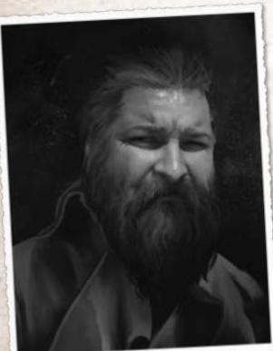
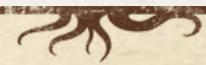
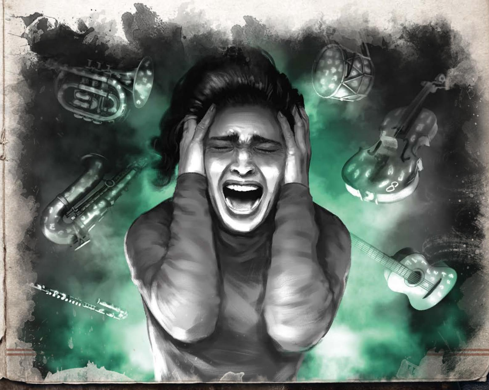
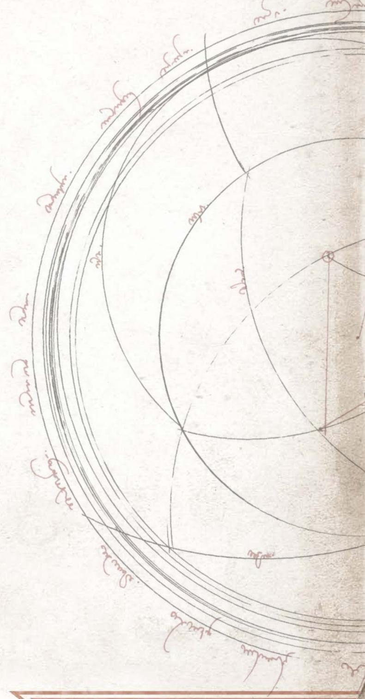
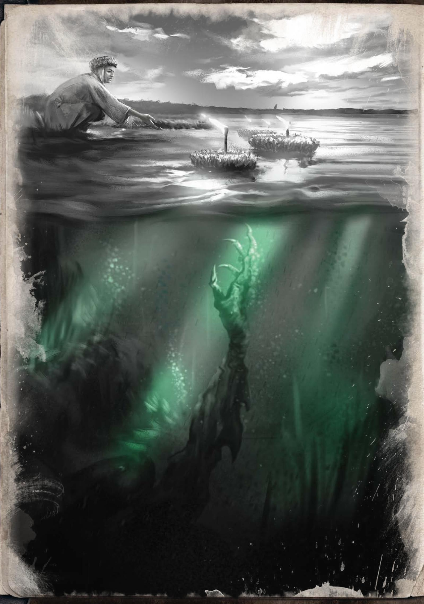

# 最短夜（初译）

> 由 open-design/mimo-v2.6-flash 分 12 节译出，待对照 [[译名对照表]] 校对。

## 最短夜

守秘人请注意：下面这个故事发生在一个虚构世界里——那是调查员在精神崩溃的瞬间，于自己脑海中构筑出来的。这个世界只是她对**1925 年之前**所发生之事的想象。在真实世界里，从那以后已经过去了十五年。但对阿莉齐娅而言，时间有一半是停住的：日子和月份在变，年份却不变——无论是日历还是报纸，对她来说永远都是 1925 年。

本模组是以女性主角阿莉齐娅的视角写成的，不过让男主角上场也毫无问题。比如，"阿道夫"（Adolf）这个波兰名字，在第二次世界大战永远改变它的含义之前，曾是非常流行的男性名。

## 禁忌题材

《最短夜》涉及严重精神障碍，以及与家庭暴力相关的创伤等题材。开跑之前，守秘人应当确认扮演阿莉齐娅或阿道夫的玩家已经做好直面这些内容的准备。为了拉开玩家与所扮演调查员之间的距离，可以考虑让玩家选择与自己性别相反的角色。

## 这一切是怎么开始的？

阿莉齐娅杀死了自己的父亲。

多年来，她一直活在恐惧之中，是父亲种种苛刻要求的受害者——这些要求最终演变成对她的虐待，既是肉体上的，更是精神上的。

妻子安娜惨死之后，莱奥波德（Leopold）沉溺于悲痛，开始对孩子们提出越来越多、越来越过分的要求。阿莉齐娅的兄长维特（Wit）某天干脆离家出走，把尚未成年的妹妹留给了父亲。眼看父亲一天比一天失去理智，女孩开始从他书房里翻出的那些奇幻书籍中寻找逃避。她并不清楚这些书的危险，只知道越读越多，学到的秘术也越来越深。

阿莉齐娅不知道，莱奥波德一直在利用自己的孩子，去执行一道古老的仪式——这仪式只有不可名状者最忠实的仆从才有资格触及。为了办成这件事，他此前已经把自己的妻子献祭了。

仪式失败了，因为它要求施术者对牺牲者怀有深切的蔑视与哀痛，而阿莉齐娅的父亲并未意识到这一点。莱奥波德没有去想自己为何败下阵来，也料不到随之而来的后果，他决定再试一次，而下一批祭品，正是自己的孩子。

这名教徒不得不把计划推迟。仪式只能在库帕拉之夜进行，每十五年一次——那时两个世界之间的帷幕会短暂地变薄。

但他没有料到，那位神明对他的失败大失所望，将他从仆从的位子上踢了出去，任由莱奥波德一步步滑向疯狂。

失败的仪式留下了一份额外的后果：黄衣之王的一缕意识，钻进了老实的管家埃里克（Eryk）体内。这缕意识相中了那个被怒火填满的年轻女孩——阿莉齐娅，把它当作自己新的容器。

被父亲摧毁，又受了管家耳边低语的蛊惑，阿莉齐娅抢在莱奥波德前面，亲手主持了那道仪式，把自己的父亲献了出去。女孩用大提琴的琴弦勒死了父亲——多年来，她正是被逼着在那根弦上演奏。仪式进行时，莱奥波德的尸体躺在魔法圆圈划定的位置上，那庞然的魔法、哀痛与愤怒吸引了某个难以描述的存在降临。连阿莉齐娅自己也记不清它究竟长什么样。不幸的是，她无力掌控仪式到足以阻止这场变故的程度。那东西把父亲的躯体撕成碎片，掏空了里面的内脏，这才把女孩从魔法的恍惚中拽了出来。她身上属于人的最后一根弦颤动了一下，随之而来的是精神崩溃和不顾一切的逃亡。

这个女孩被一名猎人在附近的林子里找到——浑身发抖、冻得透骨、赤着脚，裙子上沾满血迹和父亲的内脏残渣，目光空洞地望着远处，嘴里喃喃念叨着什么。她先被送进医院，随后收容进科别任（Kobierzyn）的精神病院，在整个冒险过程中，她都待在那里。

那场未完成的仪式释放出的力量一直蛰伏在她体内，正是这股力量让她藏进了一个自己创造的世界——一个坐落在幻梦境边缘的世界。现实里发生过的所有坏事，在这里统统不存在。阿莉齐娅是备受尊敬的音乐博士，父亲一直疼爱她、支持她的事业，兄长从未离开过她，至今仍住在克拉科夫近郊涅波沃米采（Niepołomice）的老宅里。她的母亲住在一家私立养老院，因为几年前被诊断出阿尔茨海默病。这里的一切，都比现实要好。

冒险开始于阿莉齐娅主持那场仪式的十五年之后，库帕拉之夜到来的前几天。女孩收到兄长发来的电报，告知父亲因心肌梗塞去世。电报里还请她回到家族宅邸，因为要当众宣读遗嘱。宣读遗嘱的那一幕中，人们会发现这个男人的最后心愿：让阿莉齐娅在他下葬之后，完成并演奏他生前一直在创作的那部作品（《最短夜》）。他觉得自己可能来不及写完一生的心血，于是把它留给了最心爱的女儿。

可惜，作品本身并没有随文件一起留下。但既然莱奥波德一直在写，它一定还在宅邸里的某个地方，必须把它找出来。

## 格热戈日·乌什查克（Grzegorz Łuszczak）——流浪汉/童年好友

在现实世界里，格热希（Grzesiek）是个富有的企业主，高中时代曾对阿莉齐娅"爱得死去活来"。如今也只有他还去医院探望她。他通常会对她说个不停，有时干脆只是坐在她身旁，任由她目光呆滞地望着前方。格热希始终抱着希望，盼着女孩有一天能恢复如初。他会出现在阿莉齐娅构筑的幻梦境中，给人留下一种印象：他是个举足轻重的人。他在梦中的形象是一名流浪汉，总出人意料地出现在各种他根本不该出现的地方。如果阿莉齐娅对他表现得友善，他便会回赠一件礼物——一枚刻着古怪符号的吊坠（旧神之印）。

幻梦境里的这个流浪汉，举止活脱脱就是个典型的阴谋论爱好者。他留着又长又脏的胡子，有一双锐利的绿眼睛。衣服大了好几号，满是泥浆、血迹和其他污渍。此人神秘莫测，可女主角似乎在哪儿见过他；尽管外表令人不快，他却莫名地博得她的信任。同时，他也是阿莉齐娅与现实之间最后的一丝牵连。守秘人可以借他之口，在调查员心中种下对这个世界真实性的怀疑；也可以让他在侵扰她的幻象或回忆之后突然现身；还可以让他在终幕场景中帮上一把。

## 维特·格热西亚克（Wit Grzesiak）——女主角的兄长

在现实世界里，他一有机会就抛下妹妹离家出走，从此对她的命运不闻不问，彻底断了往来。在幻梦境中，他却无微不至地照顾着父亲，从未离开过老宅，一直在音乐事业上支持妹妹。他身材修长、体格健壮，常出入各种画廊与宴会，永远衣着考究、恪守礼仪。他还是位小提琴演奏的鬼才。他象征着幻梦境

比压抑的现实更优越。他会协助筹备仪式。然而一旦仪式完成，女主角心中这个被理想化的兄长形象便会破灭——而这也可能成为她留在此世的原因。

## 埃里克·赞恩（Eryk Zann）——管家/不可名状者的傀儡

一位年长的德裔男子。他在这个家族效力多年，阿莉齐娅一家早已把他当作亲人。他个子不高，满脸皱纹，两侧鬓角还残着几缕白发。他永远衣着得体，和这一家人一样懂音乐，还能弹钢琴。可惜，一场仪式让他沦为了不可名状者的傀儡。黄衣之王（哈斯塔）的目的是逼阿莉齐娅按他的意志完成仪式，好让他借她的身体降生，实现其邪恶的图谋。因此，管家会帮她找回乐谱，协助她筹备那场音乐会。

## 莱奥波德·格热西亚克（Leopold Grzesiak）——阿莉齐娅之父

在现实世界里，多年的精神与肉体虐待之后，他在一场仪式中被阿莉齐娅杀死。而在幻梦境里，他是一位慈爱温柔、永远支持孩子的父亲，78 岁时因心脏病发作去世。守秘人可以把他当作纠缠女主角的怨灵、又一条通往现实的纽带，或者——通过留在屋内的笔记——把他当作哈斯塔的工具。

## 调查员导入

今天是 1925 年 6 月 17 日，星期五。白昼越来越长，所以哪怕已经晚上八点，你书房的那扇大窗仍透进大量天光。你俯身看着刚写好的乐谱，琢磨着那位永远追求完美的父亲会挑出些什么毛病。一阵尖锐的门铃声打破了夜晚的宁静。你打开门，看见一名邮差站在门外，手里拿着一封电报。你的目光立刻被落款攫住——是你哥哥维特（Wit）。

"妹妹，父亲今早过世了。尽快赶回来。明天宣读遗嘱。——维特"

给守秘人的补充信息：

- 父亲刚吃完早餐就心脏病发作；
- 维特叫了医生，但没能救回来；
- 葬礼定在下周举行，筹备期间需要阿莉齐娅到场帮忙。

## 抵达家中

你会作何决定？虽然时间已晚，你是叫司机扬过来，还是独自开车去涅波沃米采？你深爱的父亲已经离世了。你还记得和他最后一次交谈吗？维特一定已经崩溃了。

车停在老宅门前，尽管情形令人心碎，一种熟悉的安宁仍包裹了你——这个地方总能给你这种感觉。说来也怪，音乐学院的工作近来确实把你耗得厉害，你连片刻工夫都抽不出回家看看；可话又说回，你这趟回来的缘由，实在让人高兴不起来。走向大门时，你注意到一个衣着邋遢的男人正盯着你打量：花白的络腮胡，一双绿眼睛。他看起来莫名地眼熟。"日安，美丽的女士。"他说，"您可有些日子没来了，但愿这回是回家长住。"那人咧嘴一笑，转身朝一个只有他自己知道的方向走开了。你来到门前，还没来得及敲，门就开了，管家埃里克出现在门口；没过一会儿，你的兄长维特哭着扑进你怀里。埃里克接过你的行李，拎上楼去。剩下的夜晚，你们是在……

## 宣读遗嘱

临近中午，门外响起了敲声。埃里克开门，把一位衣着考究的女士让进客厅。她摘下头巾，露出一头乌黑亮丽的秀发。女士走到桌后，戴上白色棉手套，从公文包里取出一封火漆封缄的信封。她将信封高高举起，如同擎着某种神圣的信物，又用手势示意火漆完好无损。等在场每个人都看清了信封，她才拆开封缄，抽出里面的信纸。

"各位，我叫乔安娜·基耶普拉，作为莱奥波德·格热西亚克先生的委托律师，我有义务宣读逝者的最后遗愿。请接受我对这场丧失最诚挚的慰问。"

守秘人注意：女律师的登场对女玩家来说可能是一个微妙的信号——事情并不像表面上那样理所当然，因为在二十世纪二十年代的波兰，女性很难进入法律行业。

克拉科夫，1925年5月25日

我，莱奥波德·格热西亚克，神志与身体俱佳，为防猝然离世，特于挚友埃里克·赞恩见证下，亲笔立此遗嘱。

我将全部家业及其附属田产留给我深爱的儿子维特·格热西亚克。产权文书存放在祖母古斯塔夫留下的一只旧箱子里，箱子在我卧室。

我将自己最珍贵之物留给我深爱的女儿阿莉齐娅·格热西亚克。倘若我写下这些话时，读到的正是我的朋友，那说明我已来不及完成毕生心血。《最短夜》是我近几个月一直在创作的作品，我把它托付给阿莉齐娅来完成。再没有谁比她更适合担此重任。我最后的心愿是：愿她在夏至之夜，于涅波沃米采城堡演奏这首已完成的作品，以纪念我。

我还将心爱的钢琴送给我真诚的朋友、我们家的精神支柱埃里克·赞恩。我也谦卑地请求他照看我的妻子安娜·格热西亚克（娘家姓迈伊），并在我妻儿需要时，尽一切所能提供帮助。

莱奥波德·格热西亚克

乔安娜请你签署一份文件，证明你是遗嘱宣读的见证人之一。

## 场景、幻象与回忆

这里收录格热西亚克家宅中各个房间的描述。每个房间都可能唤起骇人的幻象或回忆，一点一点地瓦解调查员脑中那个安宁美好的世界。守秘人可以随意挑选、穿插这些事件。请记住：有些房间，调查员肯定会不止一次踏进去。

**给守秘人的提示：** 宅中藏有三套与仪式相关的乐谱：一套是真正的、毫无差错的《弗兰尼小熊的坏梦》（收在地下室一只上锁的小盒里），另一套是它的歪曲版本（放在舞厅里）。此外，在守秘人指定的某处，或者干脆在阁楼上的大木箱里，还能找到莱奥波德没写完的那首曲子。

## 舞厅

房间宽敞，窗户又高又尖，一天中大部分时候都被照得通亮。屋里只有寥寥几件东西——一架巨大的桃花心木钢琴，一把通体鎏金、雕饰华美的竖琴。触碰钢琴可能唤起一段回忆。四面墙上各挂着一幅画，画的是四季之一。这会让调查员想起，当年她躺在地板上、竖起耳朵捕捉每一个音符时，父亲最常弹的正是维瓦尔第的《四季》。如今在高校任教多年，她忽然发觉，其中总有一个音是错的。如果她决定照正确的谱子弹下去，就会发现：仅仅头几个键按下去，一条通往阁楼的暗道便悄然开启。

## 幻象

1. 你坐在一间大厅里。宽大的窗户涌入大片阳光，晒得皮肤暖洋洋的。你手里攥着一块灰色的木头积木，四周还有许多和你一样的人——目光呆滞、面容哀戚，机械地摆弄着面前的物件。你面前站着一个留胡子的男人，他笑着说：“有人来看你了。认得他吗？”一个高个子男人走到你跟前，一双碧绿的眼睛锐利而深情地望着你。你觉得似乎在哪儿见过他，却怎么也想不起来。“阿莉，我知道你认不出我，”他说，“但我确信，总有一天你会回到我们身边。格热希在等你。”

2. 头顶的天花板脏污开裂，一缕蛛丝垂下来，你这才意识到——这里不是你的房间。

你躺在一间小牢房的窄铺上，双手被约束衣死死捆住。一个体态臃肿、留着花白大胡子的男人俯身看着你，扶了扶眼镜，开口道：“阿莉齐娅，你得在这件约束衣里待一阵子。你要明白，这都是为了你好。这周你已经第三次自残了。我真的不知道该怎么才能让你听进去。”他露出一个苦涩的笑容，取出一支硕大的注射器。“做个好梦。但愿你这次终于肯回到现实中来。”

## 回忆

1. 你躺在舞厅的地板上，紧紧抱着心爱的毛绒玩具熊。维特和父亲在两架钢琴上合奏《四季》。这是一个安宁惬意的夏日，暖光透过巨大的窗户铺满一地。你听见一个错音——绝对是哥哥弹错了。你抬起头，虽然听不见父亲在说什么，却看得出他有多暴怒。他冲着泪流满面的维特大吼。维特的手仍僵在琴键上，父亲一掌拍了下去。一声痛苦的惨叫惊醒了你的梦。

2. 你和维特满屋子乱跑，玩着抓人游戏。两人一路冲进舞厅时，你脚下绊了一下，失去重心，一头栽进大鼓里，把鼓面撞得裂开。维特立刻伸手要把你从鼓里拽出来——他抓住你的一只手，另一只手已经落在你父亲手里。父亲的脸色写满震怒。两人合力把你从鼓里拖出来，紧接着，父亲张开手掌，狠狠扇了你一记耳光。

## 厨房

现代而宽敞的房间，打理得井井有条，样样物什都被埃里克（Eryk）备得妥妥当当。屋里有一张大餐桌、放厨具的橱柜、一座巨大的瓷砖炉灶和一台电冰箱（自 1913 年起德国就有电冰箱出售，所以富人随时能弄到一台，哪怕它在波兰尚未普及）。厨房与餐厅相通，餐厅里摆着一张长长的橡木桌，配几把蒙着绿布的漂亮椅子。这里窗户不少，垂着丝质窗帘。

当调查员走进厨房时，必须进行一次意志检定。检定失败，就会触发一段幻象或回忆。这也是让埃里克突然现身的好时机——他赶来安抚调查员。

## 幻象

1. 你感到一阵强烈的饥饿。大概是压力太大了。你走到冰箱前。你记得清清楚楚，就像昨天一样：父亲从德国的演出回来，把这台极其好用的机器带给你，当作给你的报酬。直到今天，用得上它的人也没几个。你打开冰箱——一股冷气扑面而来，很是惬意，可那股味道……到底是什么鬼东西？你朝架子看去，盘子里放着一颗人类的心脏。它仍在跳动，涌出的血如急流般灌满冰箱。这副景象强制你进行 SAN 检定（1/1D3 理智）。你难以置信地揉了揉眼睛，发现那只是一块普通的烤肉。

2. 你坐在桌边，享用埃里克准备的美味晚餐。你享受着与家人朋友共度的时光。忽然，你喘不上气。你轻轻捶了捶胸口——是不是噎着了？可你随即觉得，有什么柔软的东西缠上了你的脖子。丝绸？你反应过来：就在你背后的窗帘，正一圈圈勒紧你的喉咙。你听见自己的心跳慢了下来。你缓缓沉了下去。这样也挺好。

## 回忆

1. 烤姜饼的香气弥漫在厨房和餐厅里。浓得连阁楼都能闻到。维特特意为你做了个模具，好让你能从面团里切出小熊形状。这就是你的好哥哥。你知道他永远会保护你，永远会支持你。可他为什么提着手提箱来找你？为什么眼睛那样悲伤、低着头？为什么告诉你他再也撑不下去了，他的手和手指已经断过太多次？为什么他要走？你追上去，家门却重重地关上了。“随他去，”你听见父亲低沉有力的声音，“有你就够了！”

## 阁楼上的天文台

落满灰尘的房间，堆着旧纸箱和多年来攒下的各种杂物。屋子中央架着一架巨大的望远镜，对准高高开在穹顶上的窗户——这面穹顶就是房间的天花板。侦查检定成功，可以看见刻在仪器金属上的神秘学符号，还有一根巧妙缠绕其上的大提琴弦。奥秘检定成功，则能明白这些符号意在显现不可见之物。通过望远镜望去，夜空中有些比宇宙虚空还黑的点，排成一个诡异的星座。那是卡科萨的黑星。看见它们需要进行 SAN 检定（损失 0/1D2 理智）。

## 事件

你来到阁楼。除了无处不在的灰尘和密密麻麻的蛛网，这里还立着谱架和各式乐器——一把绷断了弦的开裂大提琴、一面破鼓和一支圆号。翻找同样堆在这里的纸箱和手提箱时，你翻出几张旧照片、爸爸妈妈的情书，甚至还有你作的第一支曲子《弗兰尼奥小熊的噩梦》。你都忘了家里竟还留着这样的宝贝。忽然你抬头望去，看见天花板上刻着三个四分音符，画在一条几乎看不见的五线谱上。像是有人把黄色颜料填进了刻痕，而音符本身歪歪扭扭，拼成某种符号。凑近细看才发现，这些音符并非寻常的刻痕——它们像是用指甲刮出来的。

## 幻象

如果调查员决定找出那首童年曲目并把它演奏出来（它是为小提琴写的），就会发现曲子有些地方不对劲——某些音走调了。把这些地方换成从阁楼（strych）上拿来的乐谱，阿莉齐娅（Alicja）便会看到下面这段幻象：

你站在大厅里，穿着最喜欢的那件蓝底碎花连衣裙。你在拉小提琴，演奏自己的第一首曲子——正是它让你更加深深地爱上了音乐。爸爸一定会很骄傲！可他此刻就站在你面前，双臂抱在胸前，脸色阴沉。你又拉了几个音，父亲开始焦躁地用脚打拍子，脸上的神情愈发不耐。忽然，他走上前来，一把将乐谱从谱台上扫落。不安与恐惧攫住了你。父亲为什么要做这种事？为什么要冲你吼叫？你低着头，乖乖站着。泪水从你眼中滚落，滴在散落一地的纸上，把音符洇得模糊不清。"太糟糕了！你拉得这么平庸，简直是在侮辱我！"——父亲的声音在你整个脑中轰鸣。你弯下腰，去捡那些被泪水浸透的乐谱，想把还来得及保住的东西抢救出来。可弗兰尼奥（Franio）小熊的噩梦已经不是你的曲子了——你手里的乐谱，并不是你写的。这是《最短夜》（Najkrótsza Noc）。你抬起头，忽然发现自己站在客厅里，就在公证人宣读父亲遗嘱的那个位置。你手里捏着的，是那支要演奏的曲子的第一页。

## 回忆

已经过了好几分钟，谁也找不到你。你可真是捉迷藏的高手。也可能是因为，不是人人都爱爬阁楼吧？忽然你听见一阵嗡嗡声。原来黄蜂也看中了你这处最好的藏身之所！你惊慌失措地往外冲，一边跑还一边不停地回头看。结果脚下一绊，在楼梯上结结实实摔了一跤。浑身是伤的你，正好倒在父亲脚边。"起来，动动手。行了，可以练，五分钟后楼下见。"

## 卧室

这栋房子里总共有六间卧室——两间属于阿莉齐娅和维特（Wit），父母的主卧室，埃里克（Eryk）那间较小的卧室，还有两间客房。房间彼此几乎一模一样，只有主卧配了一张带帷幔的大床。其余房间里都有衣柜、书桌和搁架，上面整整齐齐摆着住客的私人物品。每间卧室都带一间浴室，里面有铸铁浴缸、洗手池和马桶。浴室里都插着鲜花。那气味或许会唤起童年的美好回忆，只是片刻之后，回忆里便会闪出父亲虐待你的片段。所有浴室看起来都差不多。

## 回忆

1. 你走进浴室，看着镜子里的自己。你的脸被打得青一块紫一块。你低头看手——上面全是血，水泡已经磨破了，还是说又在起新的？很难讲，因为有些已经包上了绷带。前臂上有一道道红痕，像是有人拿琴弓抽过。你再看向镜子。这样过了多少年了？你还能忍多久？你有办法改变吗？你哭肿的双眼似乎迸出了一瞬黄色的火焰，不过多半是你看错了。

## 图书室/阅览室

房间有几扇大窗，窗外没有任何遮挡。地上铺着一张漂亮的彩色地毯。四面墙边都立着手工打造的书架，架上堆满了书。其中很大一部分讲的是音乐及其历史，这里还保存着各种作品的乐谱手稿。房间里有个地方显得格外特别。阅览室的角落里放着一把绿色扶手椅，旁边挂着一个小书架，上面有几本书。其中一本是莱奥波德·斯塔夫（Leopold Staff）的诗集《权力之梦》（Sny o Potędze）。如果调查员想仔细翻看这本小书，就会发现它只剩下一个封皮。内页被挖空了，像是有人把钥匙藏在里面，可钥匙本身已经不见。此外，调查员还可以进行一次*观察*检定。若成功，她会在其中一个书架上找到一本磨损严重的书，书名为*《黄衣之……》*（原文此处无法辨认）。把它从架上取下，书后便会显出通往阁楼观星台的通道。

## 幻象

1. 你环顾房间。忽然间，你感觉灯光暗了几分。屋里变得阴沉昏暗，地板上的地毯消失了，原本的地板也化作一片灰扑扑的脏污地面。四周不再有摆满书的书架，窗户也不见了。原处立起一排高大的玻璃门柜，里面装着各式医疗器材：注射器、针头和绷带。「阿莉齐娅女士，该吃药了」——你听见身后传来一个声音。你试图转身，却动弹不得，因为你身上穿着的约束衣把你的动作捆得死死的。

## 回忆

1. 父亲坐进那张绿色扶手椅，把你抱到膝上，用字正腔圆的语调给你读《权力之梦》（Sny o Potędze）。你想起了那个温暖的春日，那天下着雨，却格外舒服。「总有一天，这会变成我们的梦——等他终于肯接纳我的时候」。父亲的话你听不全懂，可此刻回想起来，一股莫名的寒意窜遍全身。

## 地下室

守秘人注意事项：建议让调查员*最后*才走到这个房间，途中至少先经历几段回忆。

地下室里放着锅炉、发电机、储物架、旧工具，还有阿莉齐娅（Alicja）藏日记的暗格——日记记着她如何被父亲虐待、维特（Wit）如何离去，以及格热希（Grzesiek）那个可爱的微笑。调查员在这栋房子里经历的所有回忆，都在这里得到印证。屋里还有一张乐谱，是《玩具熊弗兰尼奥（Franio）的噩梦》的原始版本，上面的音符正好补进莱奥波德（Leopold）那首曲子缺失的部分。暗格的钥匙在埃里克（Eryk）手里，他不愿让阿莉齐娅知道真相。不过，若有人直接问埃里克有没有钥匙，他会把钥匙交给调查员，并说阿莉齐娅临走前特意交代过：钥匙由他保管，只有她本人明确开口才能交出。关于钥匙的线索可以在图书馆/阅览室找到；和埃里克多聊几句也有收获——通过一次困难的侦查检定，能看出钥匙挂在他脖子上。地下室本身阴森逼仄，和房子里其他地方截然不同。所有令人不适的地方，都藏着一段真相。

地下室不会引发任何幻象或回忆。光是这里的气氛，就足以让调查员察觉它与房子其余部分格格不入。这是唯一一处没有被阿莉齐娅的心灵改写的地方——仿佛她给自己留了一扇小门，好让自己有朝一日能向自己坦白她做过的事。

## 其他幻象示例

1. 你正往下走，楼梯忽然变成一道平缓的斜坡。有那么一瞬间，你觉得自己在往下坠，但这种感觉很快消失了，取而代之的是某种像是……在推独轮车？你紧张地四下张望，发现自己坐在一辆轮椅上，由一个没脸、穿着护士罩衫的人推着。你试着站起来，却发现手脚都被捆住了。你已经不在楼梯上——轮椅正沿着一条走廊前行，那地方像极了一间昏暗肮脏的医院。一个声音在你脑中响起：「别怕，阿莉齐娅，一切都会好的，我在这里——记住，回来」。那是个男人的声音，听着既亲近又遥远，却十分令人安心。

2. 你感觉到粗厚的皮带勒紧了你的手腕和脚踝。你想尖叫，可有人往你嘴里塞进一个硬邦邦的物件，你发不出半点声音。你眼睁睁看着那些穿白大褂的人用注射器抽取某种药剂，把针头扎进你的手臂。冰冷的金属刺穿皮肤，随后，黑暗再一次将你吞没。

## 最终场景：音乐会

给守秘人的提示：最终场景有两种处理方式——走规则，或者全程纯叙事。关键是让调查员真切感受到自己每一次抉择的分量。说到底，玩得开心才是最重要的。

本场景默认玩家会听从 NPC 们的建议，在涅波沃米采城堡演出。那里是绝佳的场地；不过如果玩家临时决定换地方，你得做些调整。

你站在城堡的庭院里。高墙投下的阴影让四周的空气凉爽宜人。埃里克把一切安排得无可挑剔。一排排白色座椅让人想起婚礼仪式，但你们来到这里，是为了礼赞你父亲毕生的心血，而不是哀悼他的离世——所以这番布置倒也合情合理。舞台上摆着你的大提琴。

你在乐器前坐下，摆好乐谱，准备晚上的演出。就在这时，你突然听见聚光灯预热时的咔哒声，一道明亮的光柱打在你身上。几秒钟里，你看见眼前站着一个留着灰色小胡子的男人，手里攥着一支小手电，正冲着你的眼睛照。接着，你又回到了舞台上，置身于聚光灯下。你身着晚礼服，手中握着琴弓。你不由自主地把弓弦搭上去，开始演奏那首你和父亲共同谱写的疯狂旋律。方才还空无一人的座位，此刻已坐满了人——他们专程赶来听你的演奏。

你随即意识到，每一张面孔上都覆着一层白瓷般的苍白面具。尽管你看不见他们的眼睛，却能感觉到那目光正紧紧钉在你身上。那些盲目的注视仿佛要灼伤你的皮肤。

## 演奏会机制

演奏会随时可能被打断，只要调查员决定留在梦之世界。这个决定会给她带来噩梦般的后果，所以守秘人或许该给她反悔的机会。选择中断演奏的调查员，每走几步就会失去 $\frac{1}{3}$ 的魔法点 MP（向上取整）。若在魔法点归零之前她仍未改变主意，现实那边正在进行的电休克治疗就会以最惨烈的方式收场——闪电击中玩家角色，真实世界里只留下一具空壳。

若角色决定把演奏会进行到底，紧张感会一路攀升，直到最后一个音符——它的成败将决定她的命运。

- 若她演奏得*无懈可击*——她会回到现实，从医院出院。
- 若她*出了错*——她会让不可名状者把自己的灵魂从躯体中扯出、取而代之，把世界推向可怕的后果。

一切取决于艺术/工艺（大提琴）技能检定，而检定有多难，取决于剧本到目前为止是如何发展的。

检定的基础难度为**极难**，但以下情况可以降低难度：

- 使用了《弗兰尼奥小熊的噩梦》乐谱；
- 角色察觉到周围的世界并不像表面那样；
- 找回了大提琴缺失的那根琴弦。

调查员可能获得奖励骰，如果：

- 角色与格热戈日建立了联结（也许他给了她一枚带有旧神之印的吊坠）；
- 她发现了老宅与克苏鲁神话之间的关联（星辰、器物上古怪的记号、回忆）。

调查员可能因以下情况获得惩罚骰：

- 使用了伪造的乐谱；
- 对格热戈日表现出轻蔑。

场次中出现的其他情况是否会影响检定难度或奖励骰，交由守秘人自行判断。若守秘人愿意，完全可以跳过这次掷骰，仅凭调查员此前的选择直接判她成功。

下面给出演奏会的示例流程。

1. 你试图站起来、逃走。你知道，一旦留下，一切都会改变，你的世界将分崩离析。可你动弹不得。你的手不听使唤，自顾自地拉动琴弓。忽然，一道闪电劈在椅子之间的石板路上。蓝光刺得你睁不开眼；等你回过神来，发现自己被粗厚的皮带绑在椅子上。周围站着几个人。一个留胡子的男人双手捧着一件不断迸出火花的东西。转眼你又回到了城堡。你能看见闪电击中之处留下的黑色焦痕，可观众们似乎全无反应。理智 1/1D3 点。

2. 疯狂的琴弓抽拉开始催眠你。你分不清是自己在拉动它，还是它在牵引你。每一个动作都让你越陷越深。你看见周围的世界开始改变。先是咸味钻进鼻腔，像海风的味道……可这里根本没有海，对吧？你看见城堡回廊的瓦片纷纷脱落，飞向墨黑色的天空，在风中消散。理智 1D2/1D4 点。

3. 音乐钻进你的耳朵，牵出无数种情绪。你感到泪水滑过脸颊，却没法抬手擦去。你必须继续演奏，没有任何东西可以打断这音乐。大门必须被打开，无论迎来的是福是祸。

## 第一章

4. 世界在你眼前分崩离析。四周所有的窗户轰然炸开，碎玻璃和砖块一起被抛上半空。又一道炸雷，紧跟着一道闪电劈下。你眼看着电流把其中一名观众烧成焦炭，其余的人却毫无反应。他们以斯多葛般的平静注视着你——哪怕他们自己也开始浮上半空，一点点消融进夜空的黑暗里。理智 1D3/1D6。

5. 又一声雷鸣，你发现自己再次被皮带捆住；嘴里泛起血腥的金属味，太阳穴上压着冰冷的金属圆环。"只会疼一小会儿。"一个敦实的男人说着，拉下了操纵杆。

6. 乐曲结束了，只剩下最后一页——你亲手补写的那一页……
你做出了正确的选择吗？

守秘人提示：玩家在这里还有最后一次机会改变决定，去演他真正想演的内容。

成功——如果角色选对了乐谱，或者通过了艺术/工艺（大提琴）检定，并且没有陷入临时疯狂：

最后一枚音符落尽，你才意识到自己独自待在黑暗里。正前方浮着一张苍白的面具。你伸手去够，它"啪"地一声裂开，化作齑粉。你说不清为什么，但心里松了一口气。意识离你而去；等你回过神，一个留着小胡子、穿白大褂的男人正在解开刚才还捆着你双手的皮带。"欢迎回到现实，阿莉齐娅。"

守秘人提示：这里可以直接收尾，让结局更富电影感；也可以把这场戏演完，告诉调查员真实世界里究竟发生了什么。战争与那些逝去岁月的真相很可能对她造成强烈冲击，进而引发一次疯狂发作（理智损失 1/1D6）。

失败——如果角色选错了乐谱、没能通过艺术/工艺（大提琴）检定，或者陷入了临时疯狂，那张面具就不会消散，调查员会感到一种无法抗拒的冲动，非要把它戴上不可：

面具贴上你的脸，仿佛你天生就是为它而生。你最后的念头印证了这一点。下一个念头已不属于你，因为阿莉齐娅已经不在了。只剩他——不可名状者。"欢迎回到现实，阿莉齐娅。"穿白大褂的小胡子男人说道。而那个曾经叫阿莉齐娅·格热西亚克的东西咧开嘴笑了笑，问道——"告诉我，你见过黄色印记吗？"

## 调查员属性

守秘人可以与玩家协商，随意调整调查员的属性数值，但应保留她与音乐相关的技能。

阿莉齐娅（Alicja）/ 阿道夫（Adolf）·格热西亚克，33 岁，音乐博士
力量 40　体质 50　体型 50
敏捷 60　智力 50　外貌 60
意志 70　教育 80　理智 70\*

生命值 10
伤害加成：0
体格：0
移动力：8
幸运：45

技能：历史 30%，外语（德语）40%，本族语（波兰语）80%，图书馆使用 70%，财势 70%，聆听 60%，科学（音乐）80%，神秘学 20%，心理学 42%，侦查 50%，艺术/工艺（大提琴）70%，魅力 40%。

\* 调查员坚信自己心理完全健康，理智值因此才这么高。

我，莱奥波德·格热西亚克，身心俱健，谨防猝然离世，特于挚友埃里克·赞恩见证下，亲笔立此遗嘱。

予我爱子维特·格热西亚克，我将全部家产及其附属权益一并相赠。产权文书存于我卧室中的旧箱之内，那箱子是我祖父古斯塔夫留下的。

予我爱女阿莉齐娅·格热西亚克，我将毕生最珍视之物相赠。倘若此刻读到这些文字的是我的朋友，那便说明我已来不及完成一生心血。《最短夜》是我数月来始终在打磨的作品，我把它托付给阿莉齐娅来写完。再没有谁比她更适合担此重任。我最后的心愿，是让她在夏至之夜，于涅波沃米采城堡（Zamek w Niepołomicach）奏响这支完成的作品，以为我的纪念。

赠我至亲挚友、我家的守护之灵埃里克·赞恩，我心爱的钢琴。我还恳请他代为照料我的妻子安娜·格热西亚克（娘家姓迈伊），并在我的孩子们需要时给予一切帮助。

莱奥波德·格热西亚克

