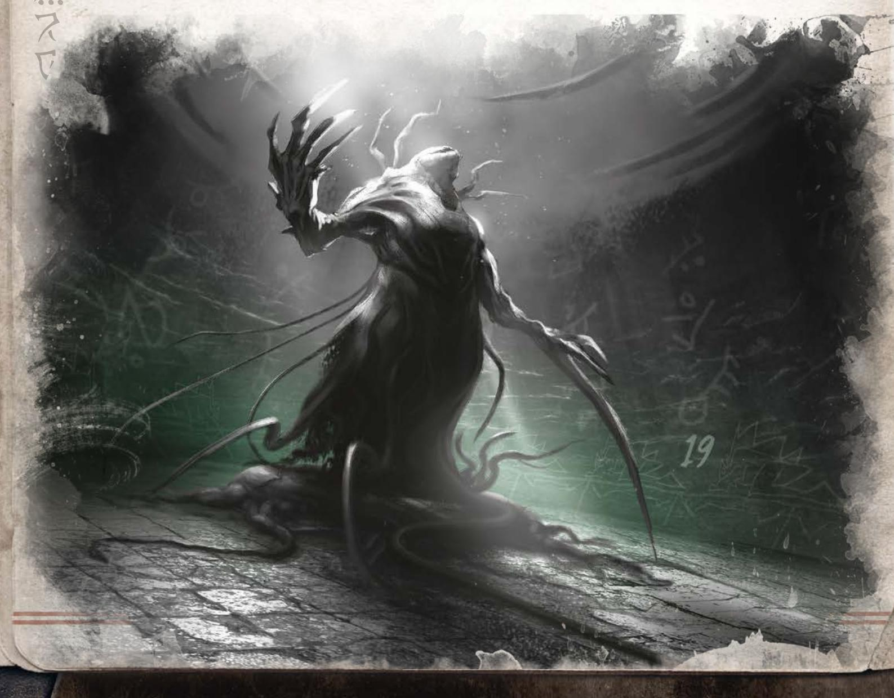
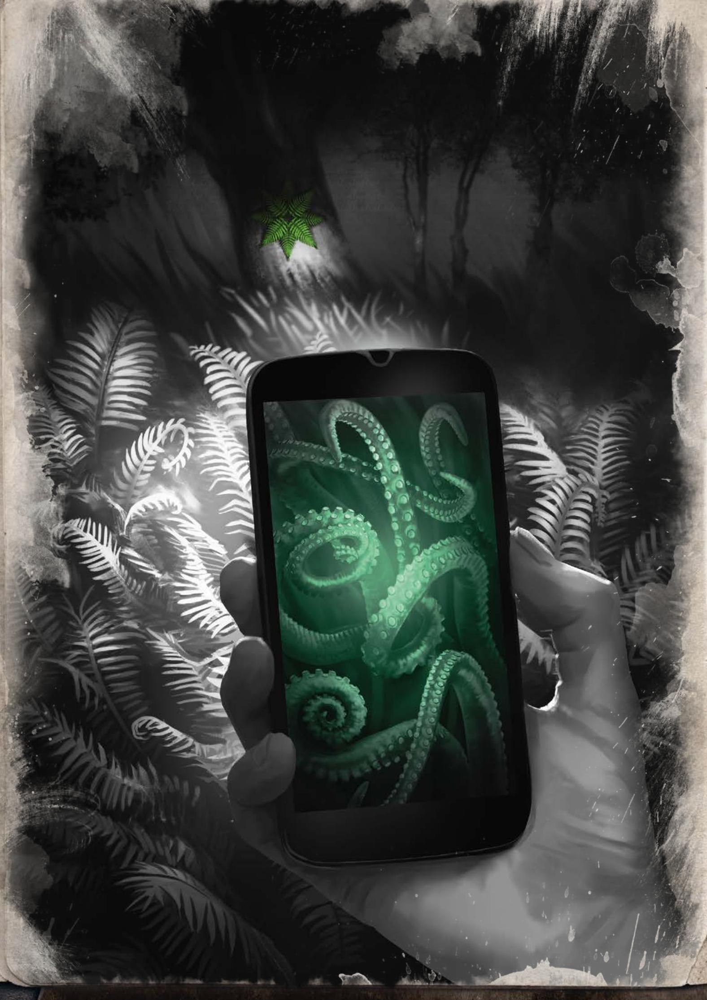

# 水上花环（初译）

> 由 open-design/mimo-v2.6-flash 分 11 节译出，待对照 [[译名对照表]] 校对。

## 水上花环

《水上花环》是一段为单人玩家设计的短小冒险，写给初出茅庐的守秘人。这是一个关于爱、牺牲与疯狂的故事，交织着斯拉夫神话与洛夫克拉夫特式的神话母题。

为了方便，本模组假定玩家、她的调查员和守秘人都是女性，而恋人——那位重要 NPC——是男性。但这对冒险没有任何影响：调查员和她心爱的人可以是任意性别。

## 注意！

这个故事里会出现艰难的抉择，以及身体与精神层面的暴力、胁迫、身体变异与畸形（身体恐怖）等情节。我们建议在开跑之前先和玩家聊聊可能的禁忌话题，并启用 X 卡（Karta X）之类的安全机制。

故事中出现的人物和地点均为虚构。鉴于库帕拉之夜（Noc Kupały）的庆祝活动在当地有悠久的文献记载，我们建议把舞台放在奥波莱地区奥得河沿岸；不过，只要场景里有河流或湖泊，冒险同样可以发生在其他任何地区。

下文会透露剧情走向的细节，这些内容只有守秘人应该看。如果你想以玩家身份体验这段冒险，请不要继续往下读。

玩家的调查员和她的恋人一起回到恋人的祖辈村庄，在那里度过库帕拉之夜。传统的放花环仪式进行时，真相浮出水面：恋人已被许德拉母亲选中，次日夜里必须前往湖底的水下神庙。而这还不是调查员唯一的恐怖源头。回到祖辈的土地、靠近那片湖水，让她的身体开始缓慢变异；按照远古契约蒙受亘古者祝福的血液，在她的血管里流得越来越快。调查员能否救回自己一生的爱？而她要付出的，会不会远不止一点人性？答案要等你们一起把这段冒险跑完才知道。

## 冒险背景

故事发生在格文比察（意为深渊）——奥波莱地区的一个小村庄，虚构，紧挨着同样虚构的希文托茨基湖。数百年前，村民与来自深渊的古老存在许德拉母亲订立了契约。每过十年，许德拉母亲便现身湖底，在库帕拉之夜选出一名宠儿，次日夜里将其带走。作为回报，亘古者把她的祝福赐给格文比察。日久天长，村民会获得化作深渊之物的殊荣。湖泊与周边土地极为肥沃，食物从不短缺。疾病和灾祸似乎绕着村子走，这里的日子慵懒平静，没什么意外。那些随母亲跨过神秘之门门槛的宠儿，再也回不来。不过，古老存在允许他们许下最后一个心愿，并会尽力替他们实现。

守秘人，在带这段冒险时请记住：因为那份远古契约，格文比察和周边的村子不一样：

- 格文比察村民的血液被打上了许德拉母亲的印记。大多数当地人是混血种（《守秘人规则书》第 328 页），他们正经历着缓慢的……

## 放花环与格文比察的一夜花

正是在库帕拉之夜（Noc Kupały），许德拉母亲会选出她的中选者。所有未在成婚仪式（swaćba）——也就是那场隆重的结婚典礼——上立过誓的人，都要参加这场仪式。不论性别与年龄，人人都得走到湖边，放出自己的花环（wianek）。其中一个花环会沉下去，以此指认出那个人：他将获得无上殊荣，前往湖底，与许德拉母亲长相厮守。格文比察（Głębica，意为深渊）正是以其独特的传统闻名。此地的仪式与别处所见不同，因此时常会有兴致勃勃的游客前来探访。村民虽然一再阻拦，却挡不住这些偶尔的造访。幸好，许德拉母亲选中的中选者向来都是本地人。直到现在……

放花环的夜晚，一夜花（Kwiat Jednej Nocy）也会出现在附近——这是一种超自然的存在，调查员可以找到它、帮助它绽放，再把它献给许德拉母亲，代替中选者充当祭品。

这就是化作深水生物的蜕变。不过，村民与《守秘人规则书》中描述的存在有几处不同。他们的变化在某种程度上取决于与湖泊的距离。一旦远离出生之地，恩赐便会离他们而去。蜕变不会继续（但也不会逆转），他们可能像普通人一样生病、死去。

- 由于身上的血脉，村民有着极具辨识度的面部特征：鼻子极窄，眼睛很大、有时微微外凸，耳朵小巧。完成最终蜕变（通常在步入中年之后），他们会前往湖底，住进那座水下城市。最年长的那些存在组成了村庄长老会，极少出现在岸边，把俗世的行政事务都丢给村长。长老会由女先知统领，她是一位掌握远古力量的教团女教徒。关于深水生物的描述见《守秘人规则书》第 327 页。

- 村民守着一个巨大的秘密，对外人也心怀戒备；但这并不意味着他们是嗜血的教徒。他们是一群在乎自己社区的人，把湖中的存在视为守护者，而非神话里的怪物。他们可能做出可怕的事，但永远是为了全村好。

- 没有任何广为人知的宗教在村里扎根，因此当地的习俗与禁忌会和波兰其他地方不同。具体有何不同，交由守秘人决定。

格文比察村内有：一所小学、一座文化活动站、村长经营的农家民宿、湖泊，以及调查员外婆的老屋。

## 家族秘密

调查员的外婆出生在格文比察。她年轻时离开了村子，从不愿提起它。直到她去世之后，调查员才决定去湖边那栋老屋看看。

外婆从未向其他家人透露村里的秘密。她很早便怀了孕。就在成婚仪式举行前夕，她的爱人被许德拉母亲选中。尽管两人感情深厚，他还是恪守了传统，走进神殿，就此离开。他被那古老的存在蛊惑、迷住，于是许愿让自己的血脉后人也能获得这份殊荣，亲历他与爱人的遭遇。外婆听见这番话，悲愤交加，在女儿出生后立刻离开了村子。

## 场次前准备

守秘人与玩家共同创建调查员。玩家可以为角色任意选择职业。有一点要注意：调查员应该是个年轻人。恋人这个角色需要花大力气塑造。请玩家讲清楚恋人是谁、两人怎么认识、在一起多久了。这是个非常重要的 NPC。守秘人应当把有助于扮演的细节都问清楚，比如：

- 恋人是谁？性格如何？
- 两人怎么认识的，什么时候认识的？
- 他是个怀疑论者，还是相信超自然之类的东西？
- 两人平时怎么称呼彼此（亲昵时怎么叫，吵架时又怎么叫）？
- 他最大的心愿是什么？
- 调查员收到过他送的哪件礼物，一直随身携带，作为两人爱情的信物？

最后两个问题对本篇故事的剧情很关键，守秘人在铺陈故事时会用到它们。

## 场景

下列场景不必全部发生。守秘人唯一能确定的，只有开场：调查员和她的恋人傍晚时分抵达格文比察（意为深渊），正好赶在库帕拉之夜（Noc Kupały）之前。两人顺利来到祖母的老屋，换好衣服，动身前往湖边。游戏应当从下面这个场景开始，一开场就把玩家的角色推进事件中心。

要记得，剧情始终跟着玩家的思路走。如果因此导致某个场景无法发生，那也没关系，不必介意——这个故事是你们共同讲述的，守秘人偶尔也该被意外惊喜一下。

## 开场场景：放花环

黄昏时分，村民们陆续聚集到湖岸，手里捧着装饰精美的花环：树枝、鲜花和野果点缀其间。小片沙滩上已经燃起篝火，一条举着火把的队列从篝火旁延伸向水边。空气中弥漫着兴奋与急切的等待，所有人都在等村长发出仪式开始的信号。

来晚的人手忙脚乱，用村里最小的孩子们先前采来的草和花临时编起花环。调查员的恋人兴奋极了，绝不会放过这个机会。也许调查员也会加入其中。

村长招呼众人走近岸边，不一会儿，十几个漂亮的花环已漂浮在湖面上。*心理学*检定成功可以提示调查员：村民们注视自己花环的方式里绷着一股紧张劲儿——这活动远不止是一场好玩的夏日占卜，它的性质要严肃得多。

终于，"扑通"一声水响吸引了所有人的注意——调查员恋人的花环沉入了湖底。村民中响起一片失望的低语，片刻之后，大家开始议论沉下去的花环究竟属于谁。

## 湖中女士的中选者

村民们围拢到调查员和她的恋人身边。人群中挤进来一位老人，拄着一根由扭曲树枝削成的木杖。这便是女先知，她用魔法在一夜之间化作普通妇人的模样。全场陷入一片紧绷的寂静。这位长老会的代表用木杖指向调查员的恋人，宣布道：

"此人便是湖中女士的中选者。当太阳再一次沉入地平线，他将前往她的神庙，为她效力。许德拉母亲的见证者们啊，欢欣吧，因为湖泊再一次赐福于你们。明天，在这片湖岸上，预言终将应验。愿达贡之父与许德拉母亲指引你们。"

## 许德拉母亲

女先知致辞之后，女调查员和她的爱人有机会向村民打听那则诡异预言。村长（sołtys）或女先知本人可以出手帮忙——两人都希望仪式能够如期举行。此外，*心理学*检定成功会让女调查员注意到：从预言公布的那一刻起，村民就用怀疑、甚至嫉妒的目光打量她和她的同伴。他们似乎并不当面翻脸，但那态度里能嗅出威胁的意味。

女调查员会得知：库帕拉之夜（Noc Kupały）每十年，湖中女士（Pani Jeziora）都会挑选一个人做她的意中人，此人将随之加入她的水下神殿。被选中是莫大的荣耀，据说在投身许德拉之前，还可以向它的化身求得一个愿望。

村民还会讲起一则传说：当年那位被选中的女子不肯抛下爱人，独自前往水下神殿。据说两人一同去了附近的林子，寻找那朵神秘的一夜花（Kwiat Jednej Nocy），打算把它献祭给湖中女士以求息怒。最后只有那位爱人独自归来，而他从此再没能恢复神智。那对村民而言是一段艰难岁月。没有守约，许德拉母亲的祝福便被收回：人和牲畜纷纷染上怪病，土地不再结出果实，长老们非但没能完成转变，反而陷入了疯狂。直到十年之后，仪式才重新举行。

## 与爱人的对话

整个局面对女调查员的爱人来说肯定相当意外。最可预料的反应是恐惧，不过这一幕有几种演法。

爱人可以相信预言，于是：

\- 被深渊里那头存在吓破了胆——村民正要把他当祭品献给它。他可能想立刻逃离此地，任何试图寻找别的出路的尝试都需要说服检定成功。若检定失败，爱人会马上动身，赶回女调查员的祖母家。

\- 尽管起初害怕，他也许会对整件事生出兴趣。许德拉母亲究竟是谁？整场仪式又意味着什么？也许爱人的好奇压过了恐惧，到头来演变成病态的着迷。这种情况下要留意：他是否会开始发疯，或受湖中女士的蛊惑（可以让他做一次 SAN 检定）。真到那一步，即便女调查员百般阻拦，他也会自己想去水下神殿。别忘了，被选中的人有权许一个愿望。开场时守秘人曾问过女玩家，她的爱人到底想要什么——这里就该把这条信息用上。

爱人也可能认定预言纯属胡扯，压根不把这回事放在心上，觉得那不过是乡下的迷信；对一切诡异迹象统统不当回事，直到真正可怕的东西找上门来。他会设法安抚女调查员，甚至故意去挑逗命运，好证明根本没什么可担心的。

以上几种反应可以彼此拼接。也许爱人起初并不相信，可经历了几桩离奇事件之后，他立刻就想逃出村子；又或者，最初的恐惧被许德拉的引诱一点点磨掉，爱人的行为随之明显转变，一下子引起女调查员的注意。

请记住：爱人如何行事，很可能决定事态的走向。守秘人该设法让这个角色成为女调查员的又一道难关，而不是一个沉默的旅伴。

## 调查员返回祖母的老屋

在格文比察（Głębica，意为深渊）逗留期间，调查员和爱人住进了湖边的一栋小屋。这屋子属于调查员的祖母，家里已经许多年没来过了。它原本属于祖母的父母——老两口变形之后，便去了湖底的水下之城。临走前，他们把房子托付给村长，请他帮忙照看，盼着哪天家里人能回来。

小屋相当宽敞：一层有带壁炉的客厅、厨房、卫生间和储藏室；二层是卧室和浴室。调查员待在这栋房子里，耳边是老木头轻轻的吱呀声，鼻端萦绕着灰尘与潮气的淡淡味道。即便如此，屋里仍相当舒适，让人产生一种虚假的安全感。这栋房子不只是临时落脚的地方——它诉说着一桩家族悲剧，也是调查员会找到许多线索的地方。

## 值得留意的物品

**家庭照片。** 数量非常多，沿着楼梯的墙壁挂着，壁炉上方挂着，连厨房里也有。调查员只认得出祖母一人，不过，*侦查*检定成功的话，还能注意到几个额外的细节：

- 照片都出自这个村子，年代全都很久远。其中几张里能认出女先知的脸。令人不安的是，村民们似乎都带有某些共同的特征，仿佛是这个地方特有的印记：鼻子极窄，眼睛大而略微外凸，耳朵偏小。调查员可能会想到，自己长得像祖母——但事实证明，像的不止祖母一个人。这一点她也许早就注意到了，但此刻安坐家中，可以静下心来仔细端详照片。她还发现，许多村民脖子上都挂着奇怪的坠子，材质看着像是鳞片。

- 调查员不知道祖父长什么样，但稍微翻看几眼，就发现一张照片里有个男人正亲吻祖母的脸颊。这个男人还出现在许多其他照片上，尤其是一组系列照——照片里一群盛装打扮的人站在湖边。可是在最新的一张照片里，他却不见了。照片上只有一个神情极为悲伤的年轻女人，身怀六甲——那正是调查员的祖母。一个神情严肃的男人把手搭在她肩上，看上去像是要把她按在原地，逼她拍下这张照片。

**祖母的日记。** 祖母把自己的日记收在一张旧写字台里。日记写得相当断续，记录的都是她一生中最重要的事件。最吸引调查员目光的是最后几条记录（参见《水上花环》——助力，第 21–22 页）。

## 转化

回到村子之后，调查员血管里流淌的亘古之血开始苏醒。在剧情合适的时机，调查员会发现自己的身体正逐渐改变，一点点生出鱼类的特征。指缝间长出蹼，背上竖起一道鳍，脖子上浮现出斜斜的疤痕——疤痕在剧痛中裂开，露出底下的鳃。

调查员的肉体转化，相当于本次冒险的一座时钟，无情地倒数着彻底变形前所剩无几的时间。来自深底的生物转化是不可逆的，所以，**守秘人**，转化的强度由你决定：或许让调查员冒险结束后身上只留下几片需要终生遮掩的鳞就够了；又或许，你更想让她为了救回爱人付出彻底转化的代价，不得不加入居住在湖底的那群生灵。

## 寻找蕨花

当调查员跨过树木的界线、开始向森林深处走去时，一次成功的侦查检定会让她注意到那里最初几处异乎寻常的景象。村子夜晚的声响渐渐隐去，取而代之的是远处的蛙鸣和滴水声。树枝上覆盖的不是苔藓，而是一层类似珊瑚的黏稠物质，泛着青蓝色的微光。枝叶几乎把天空完全遮住，但从细小的缝隙里，调查员能看到头顶的星座似乎和她此前见过的都不一样。

在苍白光线中沉浮的扭曲树木之间，调查员能望见远处闪烁的光点，还有一团如同活物般蜿蜒的、泛着虹彩的雾气。从泥泞地面里探出的树根像活体的动脉一样搏动，不小心踩上去，会咕噜一声喷出一股气。树叶和阔叶灌木上的叶脉排成神秘的图案——调查员认不出那对应任何熟悉的东西，却觉得它们正用一种神秘而陌生的语言对她说话。

森林是一座迷宫，它的任务就是误导寻找者。其间潜伏着种种危险：泥泞的沼泽、狂野的藤蔓，还有足以逼疯人的幻象。下面列出几种可能的危险。想要避开其中大部分，需要通过一次困难的侦查检定。

\- 泥沼——一片覆盖着浮萍的沼泽，会把调查员或她的同伴往下吸。在泥沼中任何剧烈动作，都会让人物陷得更深。

\- 幻象——在浓雾与黑暗中发亮的植物之间，调查员会看到骇人的形状与幻景，目的是诱使她逃跑，或在森林中迷路。建议采用"植入恐惧（Zaszczepienie Strachu）"或"心智打击（Porażenie Umysłu）"的施法规则（《守秘人规则书》第294页、第274页）。

## 一夜花

一夜花位于神秘湖泊中央的一座小小的圆形岛屿上；湖面平静如镜，倒映着人物头顶那片不属于尘世的天空。时不时，一个庞大而似鱼的形体会从水面下掠过，搅碎星光的倒影。调查员不会怀疑——自己已经不在格文比察（意为深渊）附近了。岛上有一座小码头，边缘垂着一根绳索。要抵达花朵并让它绽放，这对恋人必须通过三重试炼，每一重都要献上一件与他们的爱情过往有关的东西。

## 第一重试炼：船

湖岸旁系着一条朽坏、长满藻类的木船，配着一对船桨。船头用银链拴着一只金属锚，锚臂形状怪异而扭曲。锚的正中刻着一行字：「回忆不会让你沉没」。

人物登船、离岸之后，船底很快开始灌进浑浊的水。在调查员脚下，一个与那神秘铁锚形状相同的符号浮现出来，被超自然的光芒照亮。如果调查员决定把它扔出船外，就问她：为了不让船沉没，她愿意献出哪一段关于两人关系的重要回忆。这需要通过一次敏捷或力量检定。

## 如果试炼失败

登岛或让花绽放的尝试一旦失败，就会带来切实的肉体危险。调查员也许会选择游泳渡到岛上（她的部分变身也许能帮上忙），但这样一来，她就要面对水下那神秘生物的袭击（守秘人可以使用《守秘人规则书》第388页的鲨鱼数据），或者被荆棘划伤。

爱侣可以在这次检定中出手相助，给调查员一枚奖励骰。向玩家描写：调查员的记忆如何一段段沉入水底，湖底那道神秘的影子抓住被抛出的物件，拖着小船渡到对岸。

## 第二重试炼：荆棘

一夜花（Kwiat Jednej Nocy）被一圈由浓密荆棘藤蔓编成的笼子围住。如果调查员靠得太近，或伸手去碰，那株植物会用剃刀般锋利的枝条抽打他们。

笼子底部插着一把简陋的小铲，柄插在土里。和之前那把锚一样，柄上也刻着一句话：*"爱的象征抚平痛苦"*。守秘人要问：为了放出这朵花，调查员愿意把哪件承载着这段感情的物件埋进土里？这需要通过一次**意志检定**。

物件刚被泥土盖住，带刺的藤蔓便开始扭曲、枯萎，仿佛有什么病害从内部侵蚀它们。转眼之间，只剩下一地簌簌掉落的枯枝，再也构不成威胁。

## 第三重试炼：花

一夜花化作一个美丽的人形生灵。它通体泛着鲜活的翠绿，被层层深色的叶片缓缓拂动着包裹起来——那些叶片明显束缚着它的行动。它的根部压着一块石板，上面刻着：*"你的牵绊，我的自由"*。守秘人应当问：调查员会向这株植物做出怎样一个温柔的举动——通常是留给心爱之人的那种——来唤醒它？这需要通过一次**理智检定**（损失 1/1D6 理智）。即使检定失败，植物同样会苏醒，但那样一来，调查员会再失去一段关于恋人的温柔回忆。

绽放的花朵将完全舒展开来，在包裹它的叶片之间，会露出色泽绚丽非凡的光润花瓣。那生灵转向调查员，告诉它：正是托了它的福，自己才得以开花；作为回报，它现在会实现调查员的愿望，并投入许德拉母亲（Matka Hydra）的怀抱，替她守在心爱之人身旁。

## 逃脱试炼

经历库帕拉之夜与村民的对峙之后，调查员和她的恋人可能决定逃出村子。哈德拉教团的教徒察觉到了这一点，会密切盯住调查员的一举一动，同时伺机破坏——比如偷走汽车电瓶，或弄断点火线。如果他们想向外界求救，比如拨打报警电话，就会发现村里根本没有信号。

这场戏的走向很大程度上取决于调查员做出的决定，以下给出几种场景展开的建议：

- **溺亡者**：调查员和恋人成功逃出村子，哪怕只能步行。但调查员很快发现，伴侣开始被种种古怪的症状折磨：皮肤变得黏腻潮湿，呼吸越来越困难。到了最后阶段，他开始咳出黑水，那水渐渐灌满他的肺。

- **警察**：正当两人因为恋人的怪病不得不停下来时，一辆老旧的警车开了过来，车上是村长派来的本地警察。警察表示愿意帮忙，把他们重新带回格文比察。转到场景**游行**。

- **被捕**：调查员和恋人被教徒抓获，关进村中某栋房子潮湿的地下室里。转到场景**游行**。

## 游行

根据调查员的决定与行动，这一幕可能以几种方式展开：

\- 调查员和她的爱人可能被五花大绑，由村民们押着去赴命运之约。

\- 调查员也可能本身就是游行队伍的一员，而她的爱人则昂首阔步走在群情激昂的人群中，满心期待着与许德拉相见——不论那是出于痴迷，还是受了某种药物的影响。

\- 爱人则可能被一朵人形的一夜花取代，它会请求调查员陪它走完这最后一程。

想一想该怎么呈现这一幕——你可以直接采用下面的描写：

夜色温暖，万里无风。空气里浮着椴花的甜香，虫鸣细碎。平静的湖面宛如一面镜子，映出漫天星斗，也映出岸边那群盛装而行的人。你能感到一种欢欣的期待弥漫四周。所有人都穿着白袍，各处绣着古怪的花形纹样。有人举着火把，驱散夜的黑暗。已经无需再掩饰真面目了，所以你看得清楚：人群中有相当一部分更像水下的生物，而非人类。有时变化并没有那么剧烈——你偶尔能看见指间的蹼、鳃，或者代替双脚的鳍。你也知道，自己的身体同样在改变，而且你拿不准这是否还有逆转的一天。

长老会的一位代表用火把点燃了沙滩上堆起的巨大柴堆。火焰立刻吞没了干枯的枝干，她站在柴堆前，高举双手。你看见她皮肤上的鳞片泛出金属般的冷光。

片刻之后，从她那张畸形的鱼嘴里吐出一串你听不懂的词句。但你很快就明白了其中的意思，几乎是出于本能：

> “兄弟姐妹们！让我们赞颂许德拉母亲，湖之主宰，深渊的女主人！看啊，我们和数百年前的先祖一样，来到这里，见证又一场联姻。女主人邀请我们的血肉、我们的身体与灵魂，到她水下的宫殿共赴盛宴。她赐予我们健康与庇护，而她所求的，不过是一个愿意陪她前往未知之地的伴侣。那么，就让我们出发吧——不要让许德拉母亲久等。”

前往神庙的路途，需要水下呼吸的能力。若调查员的意志检定成功，她可以动用自己新长出的鳃。若检定失败，她可以向村民讨要（或偷来）一枚鱼鳞吊坠。这是一种造型古怪的饰物，专供没有鳃的人佩戴。仪式之夜，人人都受到邀请，就连没有得到达贡与许德拉母亲明显赐福的生灵也不例外。吊坠上刻着一个奇异的符号，浸水之后会泛起淡淡的蓝光，让持有者得以获得氧气。

向调查员描述这段水下旅程。湖深得不合常理。湖水起初是温的，每下潜一米就更冷一分。篝火与星光的光芒还能再往下渗入片刻，但很快，调查员就被密不透光的黑暗包围了。只有在某些地方，还能瞥见吊坠发出的微弱光亮。当游行队伍接近湖底时，前方浮现出一圈冷绿的幽光——那是队伍抵达神庙的标志。

## 仪式

达贡父亲与许德拉母亲的神庙，是用一种近似黑曜石的黑色石头砌成的。石面上凿刻的青绿色符号泛着令人不适的微光，却也是此地唯一的光源。

队伍最终抵达一间没有穹顶的巨大圆形厅堂。抬头便能望见深渊般湖水的幽暗。大厅正中央是一方表面光滑如镜的黑色水池——那是通往另一个世界的门。当调查员走近到足够近时，会发现石头并非纯黑——其中映着陌生的群星。仪式进行时，许德拉母亲的化身就将从这里浮出。厅堂四壁嵌着古怪的浮雕，刻画的是一群鱼人，正向一具在它们看来美丽绝伦的海中生灵顶礼膜拜。

调查员的爱人被带到了大厅中央。女先知抽出一柄骨匕，划破自己的掌心，缕缕血雾自伤口升起。就在此刻，圆形洞口四周的符号开始泛起青绿色的辉光，一头庞然巨物自黑暗中浮现身形。许德拉母亲的形貌近似鱼人：浑身覆着青绿色鳞片，一双鱼眼锐利地扫视着在场众人。这景象对调查员来说太过刺激——请玩家进行 SAN 检定（1/1D6 理智）。

那生灵并未张开窄小的嘴，低沉的嗓音却直接在众人的脑海中响起。

"欢迎你们，我的孩子们。正如许多个世纪以前那样，今天我也将收下你们的献礼。你们的收成会丰饶，你们的孩子会健康，你们的寿命会长久。而当那一刻到来、你们的血肉准备就绪，你们便能加入我，在水下的王国中长伴左右。"

调查员看见那生灵伸出一只生着利爪的蹼手，探向她的爱人。两枚指尖之间夹着一只花环——那还是昨天刚编成的。请描述：许德拉母亲如何将花环撕成两半。

"在我带你踏上我们共同的旅程之前，我可以满足你一个愿望。只要记住，你的命运已与我相连，再也无法回头。虽然……"

那造物将目光转向调查员。

"失落的血脉回来了。我一直在等。我知道你终会回到这里。我不想再一次失去你，所以，也许我该先实现你的愿望？然后再带你一起走。这是你祖父的意愿，是他最后的心愿。"

## 林中疯狂

在寻找蕨花的过程中，调查员和她的爱人都可能发疯。若是如此，他们会走出森林，被村民发现。爱人将在仪式中被献给许德拉母亲，而调查员则可以留在湖边外婆的家中，逐渐彻底转化为深海的生灵。她当然可以离开格文比察，但变形不会消退，外貌上的异样会招来好奇或不友善的目光。

## 仪式

如果冒险以仪式场景收尾，可能会有几种后续。许德拉母亲可以在愿望实现之后带走蕨花或爱人。但她也可能要求另一种代价。

## 最后的愿望

在带走被选中者之前，许德拉母亲会答应实现他（她）的一个愿望。她拥有超自然力量，神通广大，能办到的事多得很。但务必记住：这个愿望无论如何都不能妨碍亘古者完成仪式、携所选之人穿过那道门。愿望可以改变某人的记忆，也可以把某人送到别处。许德拉母亲答应什么、又拒绝什么请求，由守秘人决定。

如果献上的不是爱人，而是一夜花，许德拉母亲就不会撕开花环。调查员和在场所有人都会在脑海中听到一个声音：

"你不是我选中的那个。但我找你已经很久了。现在，你逃不掉了。你将随我前往拉莱耶，面见沉睡者，完成你的宿命。"

仪式落幕，愿望实现之后，许德拉母亲带着调查员、爱人或蕨花一同离去，没入星环之中，从众人眼前消失。

## 结局

如果调查员决定牺牲自己换取爱人的性命，就应当允许她这么做。冒险到此结束——没有人，连守秘人也不知道星光之镜的另一侧究竟是什么。

这场故事的所有结局都无法被预见。前述的场景未必都会发生。也许调查员到不了水下神殿，也许她找不到蕨花。因此下面只列出几种可能，供守秘人参考。

## 爱人的死亡

由于调查员的所作所为，她的爱人可能没能前往水下神殿。这种情况下，他将不幸死在她的怀中，被诡异的黑水呛溺（参见：溺亡者），而村庄也将失去许德拉的庇佑。

## 一切之后

如果调查员活过了剧本，并决定留在湖边，她的异变会不断加深，最终变成深水中的造物。那样的话，她终将获得殊荣，住进达贡与许德拉母亲的水下王国。

如果调查员离开村子，她可能会决定继续寻找与那些神话有关的线索。也许这将是一段新冒险的开端——一个悲惨的开端，因为在余生中，她将不断梦到爱人最后的时刻。

## 安东尼·弗卢斯曼（Antoni Flussmann），村长

四十多岁的男人，身材瘦削，黑色短发剪得很利落。和其他村民一样，他长着间距很宽、微微外凸的眼睛和窄窄的鼻子。说话带一点外国口音，像是德语腔。虽然为人严厉，但待人客气，话也多。他在村民中深得拥护，是村子延续不断的象征。为了保住许德拉日后的庇佑、确保仪式按传统举行，他什么都肯做。

力量 60 体质 60 体型 40

敏捷 70 智力 80 外貌 50

意志 50 教育 60 生命值 10

伤害加成：0

体格：0

移动力：9

魔法点：10

技能：历史 50%，克苏鲁神话 2%，说服 60%，游泳 70%，心理学 60%，隐藏 40%，威吓 50%。

## 女先知

多年前她经历了异变，加入了栖居湖中的深水造物之列。她担任达贡与许德拉的祭司，在村子的重要庆典上现身。教团事务由她拍板，村长只是执行她指示的人。观察力敏锐的调查员有机会瞥见女先知沉入湖中，并在沙滩上留下一串鳍痕。

属性参见《守秘人规则书》第 327 页的深水生物。此外她还掌握咒文：戈尔戈罗斯肉体畸变（《守秘人规则书》第 280 页）、深渊之息（第 272 页）、神祇召唤（第 291 页）。

## 一夜花

一种强大的超自然存在，在地球上只有库帕拉之夜才可能被找到并绽放。据说它会出现在不同的位面和星球上，扰乱世界之间的界限。它非凡的魔法能量是亘古者及其忠实仆从的养分。传说它可能是唤醒沉睡在拉莱耶深渊中的克苏鲁的钥匙。

## 1965年3月12日

现在我可以确定了。离上次月经已经过去很久，这一周我一直在犯恶心。我不知道该怎么办。我大概会是个好母亲，我们的女士也会为每一胎降生而欢喜。可另一方面，我不清楚亨内克是不是当父亲的料。再说，我们本来打算出去走走，去看看这个世界。波兹南、华沙，去哪儿都行。早晚我得告诉他。

## 1965年4月7日

我终于说出口了。再瞒下去也没用，肚子眼看就要显怀。那个浪漫的傻瓜听了，居然高兴坏了。

哦，他可真是高兴，傻乎乎的笑一直挂在嘴角。他答应我，暂时把画画搁下，先去找份正经活干，好养活我和孩子。难不成我是玻璃做的？等生完孩子，我也许可以去热恩杜夫（Rzędów）的面包房做工。父母也很满意，只是提醒我们，必须办婚礼，免得邻村的人说闲话。我们这儿没人在乎教堂那一套禁忌，可我们不想让人起疑。还得好好办一场成婚仪式。我们要站进湖水里，按规矩立下誓言。

## 1965年6月4日

小家伙已经在踢我了。不知道是不是女孩，可我心里就是这么觉得。身子越来越沉，脚踝又肿了。卡霞老缠着我去放花环，于是我今天犯傻，把礼服上的针脚缝了缝。亨涅克来了兴致，不依不饶，非去不可——他说我们还没立誓，按说还能放花环。可我心里清楚，他不过是想看我踩进水里、水没到膝盖、头顶花环的傻样子。

## 1965年6月22日

## 不 不 不 不

为什么？是因为我们迟迟没有立誓吗？湖中女士不知道他是我的吗？还是说，正因如此她才看上了他？我心口上还怀着我们的孩子，她不能把他夺走。这简直是一场噩梦。亨涅克似乎已经认命了。他说反正什么都做不了，只剩最后一天。逃跑也没有意义……母亲跟我讲过那个蠢姑娘的下场，她曾经试过。我们唯一剩下的，只有蕨花。我要去求亨涅克，让我们一起去。也许疯癫就会放过我们。我怕孩子出事，可我不能一个人留下。为什么许德拉不挑一个心甘情愿的人？村里想要的人还少吗？

## 1965年10月7日

这是我最后一篇日记。我的日记会留在这里，留在家里，留在这该死的地方——这里每个角落都让我想起亨涅克。那座他第一次吻我的小码头，岔路口那棵我们一起看云的苹果树，湖边那片他画了又画的芦苇。这是漫长的折磨，我不愿再忍受下去。孩子很健康，万幸。父亲说这是许德拉的恩赐。胡说八道。要不是湖底那头冷血的怪物，孩子本来就会健康，也会有父亲。我再也不会回到这里，绝不。我会一辈子记得亨涅克踏入水中时那可怕的微笑——记得我们把他送进深处。那头野兽对他低语，向他许诺了什么，而他向来心软。每次我想回忆他的脸，看见的只有那双空洞的眼睛和歪斜的笑。还有他最后的愿望，那可怕的念想——但愿它永远不会成真。我的双脚再也不会踏上这里，我的孩子也一样。这个地方被诅咒了。

