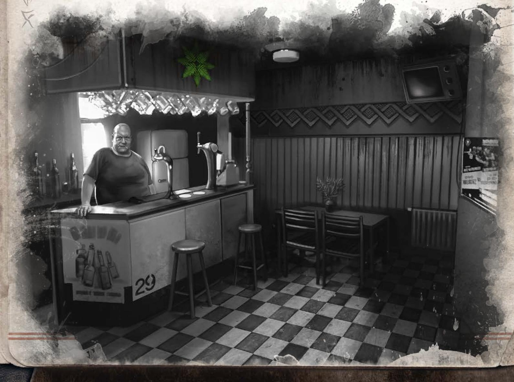

# 蕨花 AR（初译）

> 由 open-design/mimo-v2.6-flash 分 13 节译出，待对照 [[译名对照表]] 校对。

## 作者：亚历山大·道克谢维奇（Aleksander Daukszewicz）、帕维尤·尤尔吉耶乌（Paweł Jurgiel）

《蕨花 AR》（Kwiat Paproci AR）是一个供守秘人与一名玩家对跑的模组。故事发生在当代，把克苏鲁神话的魔法与现代科技揉在一起。它也讲了早期斯拉夫人的信仰，以及一个延续至今的莎布·尼古拉丝古老教团留下的痕迹。游戏舞台设在波兰的任意一座城市——守秘人和玩家一起决定地点，把冒险中描写的场景安放进合适的街区。他们还要确定调查员的身份，以及调查员与几位主要 NPC 的关系。两人之间最好存在竞争或好感，好让调查员有动机行动起来。本模组是模块化的，书中给出的场景并非仅有的几种可能；需要时，守秘人可以改动它们，也可以自行添加。

## 剧情梗概

即将上线的手机游戏《蕨花 AR》用的是增强现实技术。测试玩家交口称赞它那令人不安的迷幻氛围和超写实的画面。它有一层颇有意思的剧情外壳，取材自斯拉夫信仰，还需要玩家大量"在灌木丛里瞎转"。玩家找的不是花花绿绿的小怪物，而是"通往神明世界的门"。开发方宣布，测试将在即将到来的库帕拉之夜（Noc Kupały）收官——"群星归位、两个世界之间的屏障最薄"的时刻。

调查员所在的公会早已在这场对局中占据统治地位，登上领奖台的机会相当大。就在库帕拉之夜前夕，原本排名第一的玩家——主角的朋友或死对头——在离奇状况下失踪；其余玩家要么在亲友压力下退出，要么为了心理健康收手。于是调查员突然升到了排行榜第二。

模组会把一连串挑战摆在调查员面前。他可能想弄清对手和朋友的下落，也可能想把游戏通关、看看结局长什么样，还可能两者兼顾。游戏里的任务大多相当古怪，但都守着那句承诺——"不可思议的斯拉夫风情"。这些任务会向角色敞开神话的大门，让他在不知不觉中以开启大门所需的力量喂养那位巫师。如果角色决定通关游戏，那么在库帕拉之夜通道就会打开，角色本人也会被请进"松林姨娘（Borowa Ciotka）的家"。他接下来会怎么做，就完全取决于玩家了。

调查员可以走其中一条路，也可以把两条并在一起。

其一，他可以去查清排行榜上其他热门人选的遭遇，并揭开这款"特殊"游戏的幕后真相。这应当能让他意识到事情不对劲，进而查出游戏作者的身份。

其二，调查员可以完成那些把他引向结局的任务。这会让他亲手确认：这场游戏绝非只是玩玩而已。他将有机会参与一场仪式，借由那道门转移到另一个维度。

调查员选哪条路应当完全自由，不过让他两条都试一试会更好——这样他不仅能了解各 NPC 的身世，还能亲自撞上神话那触手可及的恐怖。

## 重要 NPC

FilipsNo1
领奖台上永远站三个人——一个失败者，一个失败者，还有我。

菲利普（Filip）天生就是赢家。在学校里，他当过每一支球队的队长。不管全班是在踢足球，还是在筹备历史辩论赛——他带队的那一组总是赢。嗯，几乎总是赢——偶尔也会有失利，但"从来不是他的错"。菲利普是迷人的混蛋与优等生的合体：英俊的棕发男子，身边常围着一圈仰慕者，用他自己的话说，就是一群"马屁精"。直到上了大学（他读的是法律），他才结识了后来成为朋友的人——至少算是接近朋友的人。他开始玩 AR 游戏纯属偶然。他听说这类游戏能带来极大的满足感，还能在与有趣的对手交锋时"检验自己"。他随手打开一款热门应用，一个月后就成了公会里的第一高手。这些玩家正是他一直在找的那种人：聪明、好胜、一心求赢。唯一的麻烦是，到目前为止，他们总在同一个队伍里。所以菲利普才会对《蕨花 AR》如此着迷。他终于有机会去"踢爆"那些懂得欣赏这一点的人的屁股了。

FilipsNo1 输不起。他有时会破坏规则，有时会抄近道，但重要的只有胜利，对吧？可惜，他最近用的这一招实在不太走运。他确信自己已经攒够了分数和线索，便提前结束了最终仪式，结果被那道通往异世界的门吸了进去。在这之前，他给排名前三的玩家各录了一段视频。从这些录像里能读出两件事：他的精神状态不太好，而且他在害怕什么。除了吹嘘之外，他还留下了帮助通关最终任务的线索。他这么做，只是为了事后能说一句：没有他，他们根本通不了关。

**在冒险中的作用**：菲利普留下的讯息以及他失踪的消息，构成了冒险的开端。查明他究竟遭遇了什么的渴望，则撑起了整条故事主线。

**守秘人提示**：开跑前，先和玩家敲定他与菲利普之间的确切关系。两人可以是针锋相对的对手、酒桌上的哥们、挚友，也可以是情人。关键在于，他们对彼此绝不能无动于衷。在终幕场景中，调查员将决定"最佳玩家"的最终命运。这个选择必须——也一定会——具有举足轻重的分量。

## Krystynator

## 离窗远点！树枝离得太近了！

每个人都认识克雷哈（Krycha）这样的人。典型的金属系假小子，最好的姐们儿，没人把她当女孩看——直到某天她穿着裙子、带着男朋友来参加派对。她不久前还是玩家排行榜的第二名，过去几周一直紧咬着 FilipsNo1 不放。几天前她经历了一次严重的精神崩溃，为此住进了精神病院。她其实并没有试图自杀——至少她是这么说的。因为"玩游戏玩得太兴奋"而长期缺睡眠，导致她一时疏忽，把处方安眠药服了过量……而且是两次。她说的是实话，只是漏掉了一个重要细节：在她最后造访的那个站点，她亲眼"看见了什么"。起初她当然没当回事——应用以前就给她显示过奇怪的东西。一棵树当着她的面把一只狍子撕成碎片，她大概也能扛住，可那棵树顺便溅了她一身货真价实的血。克雷哈记不清自己惊恐逃出树林、摸回家的细节。但她很清楚一件事：她再也不打算靠近任何树了。

**在冒险中的作用：** 由于克雷哈是调查员在公会里的熟人，这次见面应当让调查员意识到事态有多严重。女孩简直判若两人。她向来嗓门大、话多，比身边的许多男人都硬气，如今却像个受惊的小姑娘。一阵意外的风吹动树枝，就足以让她歇斯底里。在心理医生的坚决要求下，她删掉了那个应用，并尽量避免与公会里的朋友接触。不过，调查员可以去医院探望她；她手机里还留着菲利普发来的私信，其中包含第二段录音。

**守秘人提示：** 为了推高情绪，守秘人可以在本场开始前设定：克雷哈与调查员之间有过更亲密的关系。两人可以"互有好感"、是地下情侣，或曾是密友。无论选哪种，精神病院里的那一幕都会有重得多的分量。

## DisasterMaster（DM）

## 你说这个世界不像学校教的那样？认真的？那可真是个大新闻……

DM（其实就是特蕾斯卡·奥斯科罗巴，DisasterMaster）不是公会成员——因为年龄没被接纳。这位最出色的女玩家之一才 13 岁。她是个瘦小的女孩，脸庞清瘦、布满雀斑，浅红褐色的头发卷得厉害，活像一团羊毛。她的朋友大多比她大不少，所以特蕾斯卡用气场来弥补：她能说会道、自信满满，还带着一种讨人喜欢的厚脸皮。她"消失"背后没有任何阴暗的故事——她因为大半夜在废弃建筑里乱逛被父母禁足；几小时前是警察把她送回家的，这件事被定性为"彻底作死"。DM 并没有放弃游戏，她只是暂时无法参加，这让她火冒三丈。

**在冒险中的作用：** 因为调查员不认识特蕾斯卡，DM 一开始可能显得很可疑（在网上，这是个四十岁、不属于任何公会的男人）——他不但没从排行榜上掉下去，反而冲到了第一。另外，特蕾斯卡的父母限制了她的上网，想联系上她得费一番周折。DM 可能成为调查员意想不到、却出奇宝贵的助力——他知道很多事，尽管自己以为那不过是游戏里的信息。一旦他意识到自己所见的是真相，她承受起来会比任何成年人都强得多。她的头脑是敞开的，而且她"早就知道，老家伙们对真实世界屁都不懂"。

**守秘人提示：** 特蕾斯卡会想跟着调查员一起去寻找真相，但有她在会带来额外的麻烦。其一，如果她从家里逃走，父母和警察都会四处找她。其二，在故事的结局，她可能会认定自己赞同以利亚（Eliasz）。

## 蕨花 AR

力量 30 体质 50 体型 30
敏捷 60 智力 80 外貌 50
意志 30 教育 30 理智 30
生命值 8
伤害加成：-2
体格：-2
移动力：8

战斗
斗殴（拳斗）15% (8/3)
闪避 30% (15/6)

技能：电子学 35%，电气学 25%，巧舌如簧 60%，图书馆使用 35%，电脑使用 60%，克苏鲁神话 3%，跳跃 45%，侦查 50%，隐匿 55%，攀爬 30%。

马里乌什·科瓦尔奇克 / 以利亚（Mariusz Kowalczyk / Eliasz）

现在你明白了。你可以迈出下一步，与我一道揭开这个世界、以及所有其他世界背后的隐秘真相。超赞，对吧？我可是兴奋极了！

网上真是什么都能挖出来……比如说，马里乌什为一款新手机游戏找灵感时，找到了一个"仓鼠"（chomik，波兰的网盘服务）的小众版本——Ex Libris Index Expurgatorius。用户往上面放的全是教会查禁的文字。在几十篇经典科学论著和嘲骂教士的檄文之间，马里乌什翻到一份扫描版的《无名教团》（冯·容茨）初版原书。这一读，又把他牵到别的有趣文本上，为他推开了一整片新可能。折腾了几个月、又读完几本书之后，他做出了一款运用增强现实技术的革新游戏。他供职的 Slavic Games 工作室，眼下正在开发《蕨花 AR》这个项目。马里乌什借题发挥，伪造了一个"早期版本秘密内测"的网站，把本地区几十名最拔尖的玩家都请了进去。游戏起初好评如潮，可大多数人很快就玩腻了，论坛上渐渐传开一种说法：这玩意儿"氛围压抑得吓人，真的伤神"。也难怪，这款应用会从玩家身上吸走意志值，一点一点把他们推向疯狂。

以利亚（马里乌什的网名）是个天才，而且他对此心知肚明。他同时也疯了，表现为一种特殊形式的弥赛亚情结——他要让全人类知晓真相，不管人类得为此付出什么代价。只是每个弥赛亚都需要使徒。而按他的计划，使徒将从玩家当中产生。

冒险中的角色：以利亚是这个故事的"大反派"。他的所作所为把许多人逼到疯狂的边缘，还有几个直接跌进了疯癫的血盆大口。至少有两名玩家丢了性命，或者从这个世界上消失了（连以利亚自己也说不准）。他对此有些过意不去，但并不打算干预游戏进程——赌注太高了。他不是调查员的敌人，恰恰相反：他要找的正是这样的人，好把知识传授给他们，与他们分享力量。

力量 50 体质 45 体型 60
敏捷 50 智力 95 外貌 40
意志 110 教育 80 理智 10
生命值 9
伤害加值：0
体格：0
移动力：7

战斗
斗殴（拳斗）40% (20/8)
闪避 25% (12/5)

技能：电子学 50%，电气学 40%，图书馆使用 50%，电脑使用 90%，克苏鲁神话 15%，神秘学 60%，说服 65%，心理学 40%，侦查 60%。

咒文：尸鳞之咒、召唤森林女神（召唤莎布·尼古拉丝）、号令树木（缚束年轻暗影）、创造门扉、凝视门扉、寻找门扉、沃里奇之印。

## 应用程序

马里乌什拿来他和 Slavic Games 同事一起编写的代码，在里面做了大刀阔斧的改动——确切地说，塞进去几道咒语。他在游戏发送玩家前往的每个地点都安放了魔法符印。这些符号像是用蕨叶拼成的花，只有透过应用程序才看得见，它们同时也是游戏的官方标志。玩法之一就是找出这些符印，解锁由它们开启的功能。找到符号所在的地点并完成相应指令可以得分。用应用程序扫描符号，会把玩家和以利亚连在一起。这样一来，玩家在指定地点做出的那些动作——游戏里的指令——就成了魔法行为，让他得以抽取玩家的意志。

所有地点都是活性不一的大门。透过应用程序，玩家能看到大门另一侧的事物——这等于是「凝视大门（Spojrzenie w Bramę）」这道咒语的现代化版本。调查员循着 GPS 的指示辗转各地、寻找符号时，其实正望向别的世界，看见不可思议的场所与生物。不过在某个节点之前，他都应当确信这只是游戏的一环。凡是能暗示"事情绝不止于此"的情节，都要慢慢铺陈开来，借它们把故事渲染得越来越诡异、越来越骇人。

## 示例场景

## 精神病院

不要设置障碍，让调查员难以查明 Krystynator 出了什么事。她的亲近之人都已知道真相，包括她的室友或姐妹——对方会很乐意给出医院地址。这是一家半开放管理的机构，本身并不吓人。但里面安静得让人不安，至少克雷哈与调查员见面的活动室如此。女孩看起来疲惫不堪，脸色苍白，眼圈发黑。是护理员用轮椅把她推到这儿来的。

## 第三章

能从克雷哈口中问出什么？

\- 三晚前她去过公园里的站点；

\- 有只野兽在她身边杀死了一头狍子，血和内脏溅了她一身；

\- 她陷入恐慌，逃回了家；

\- 她并不想自杀，但当时受了惊吓又筋疲力尽，于是吞下了过量的安眠药；

\- FilipsNo1 给她发过一段视频，但她没看，因为她要退出游戏和公会了；

\- 她去过两个游戏并未引导调查员前往的地点（除非调查员还没做到「祝福」——那就是三处）。

此外（社交技能检定成功，或这段情节演绎得非常出色时）：

\- 那不是野兽，而是一棵树，树冠乍看像珊瑚；

\- 她说不清自己为什么吃了那么多药；

\- 她真的不会再回公会；

\- 她可以给出那些她知道、而调查员并不了解的任务地点坐标（第 1、2、3 号——「祝福」；这几个编号的含义，守秘人在「结局」的描述部分能找到）。

这场戏是展开调查员与克雷哈之间任何私人支线的绝佳机会。

## 奥斯科罗巴一家（Oskrobowie）的住处

调查员可能想找出那位网名 DisasterMaster 的玩家。据传，他是个四十多岁、身材极为魁梧的大块头，向来独来独往。据说有几个玩家曾在"任务地点"远远见过他（他们看到的未必是什么正主，反正不是 DM），但没人跟他打过交道。

要找到 DisasterMaster 得费点工夫。仔细翻查他在论坛上的发帖，再成功通过一次*电脑使用*检定，就能发现：他有好几次是在深夜用同一台台式机的 IP 登录的。父母没收特蕾斯卡的手机时，她就用家里那台台式电脑。

借这条线索，调查员可以查出排行榜新任第一名的身份。小姑娘跟父母住在一起。父母在家时，登门拜访对调查员来说恐怕会是段颇为微妙的经历——两个大人满腹狐疑地打量一个陌生成年人，只因他玩着和自家十三岁女儿一样的游戏。当着父母的面，特蕾斯卡只会说自己被禁足了，所以才没上线。要想套出更多信息，得找到机会跟她单独聊（她会给调查员的游戏论坛发私信，再从家里翻窗跑出来，这样事情就好办多了）。麻烦在于，小姑娘答应帮忙的条件是带上她一起做最终任务。说服她得通过一次*极端*的社交技能检定。

从特蕾斯卡口中可以问到：

- 是 FilipsNo1 试图把她踢出游戏——她可以出示收到的那段视频；

- 关于游戏世界的许多内幕。所有能见到的"生物"她都亲眼见过；要是有人暗示这些东西是真的，她会一笑了之，说老古董们根本不懂技术能做到什么地步；

- 她知道整段咒语的内容；

- 她能说出三处任务发生地的坐标，而调查员并不知道这三处在哪里（第 4、5、6 处——这些编号的含义，守秘人可在"结局"一节的描述中找到）。

## Slavic Games 总部

出版《蕨花 AR》的公司坐落在所选城市里最气派的摩天大楼或黄金地段。入口上方悬着巨大的标志——一位持矛的斯拉夫武士，以骰子代替盾牌。大厅里立着等身大小的人物雕像，全是该公司作品中的角色，其中几尊是《蕨花 AR》里的"怪物"。调查员一个也认不出来。这家公司处处透着大厂气象。员工是五颜六色的一群人，穿着随意，大多很年轻。访客会被引向前台，那儿摆满了蕨类盆栽。

前台有两名工作人员，玛丽希娅（Marysia）和安杰伊（Andrzej），职责是把粉丝挡在门外，而他们显然会把调查员当成粉丝。如果调查员不肯说明来意，关于马里乌什·科瓦尔奇克（Mariusz Kowalczyk），他们只会说"他肯定不在"。一旦调查员提起自己参加了《蕨花 AR》的测试，两名前台会明显紧张起来。其中一人会提议请调查员喝杯咖啡、稍等片刻，另一人则戴上无线耳机与某个大人物通话，转达访客的来由。

与项目负责人泽农·古尔卡（Zenon Górka）及其律师的会面，安排在一间陈设相当简朴的办公室里。起初气氛像审讯——因为管理层已经开始为自己的前途发愁。马里乌什·科瓦尔奇克把他们拖进了财务和声誉的双重泥潭。他们担心被参与过"假蕨花"测试的人告上法庭。以利亚让测试参与者签了某种盖着公司抬头的协议，盗用了游戏的官方标志，还让玩家置身于潜在危险之中……调查员提供的失踪事件，把问题又推上了一个新台阶，在场的人都希望这些消息是假的。如果调查员能说服他们——最好拿出证据——古尔卡会不顾律师的反对，透露一些信息。

**调查员可能得知：**

- 马里乌什·科瓦尔奇克（以利亚）已经不是 Slavic Games 的员工；
- 他因《蕨花 AR》项目被解雇——未能履行职责；
- 这款游戏还没成熟到可以测试的程度——调查员和朋友玩的东西，并非 Slavic Games S.A. 的作品；
- 散布上述信息将招致起诉。

如果调查员能向普通员工打听马里乌什，还会听到一些令人不安的说法，其中一部分确有其事：

- 马里乌什休假前就不洗澡了（传闻）；
- 他能出去吃四小时"午饭"，回来时满身泥污、头发里夹着树叶，却若无其事地坐下来继续写代码（属实）；
- 他整夜待在公司，白天却常常不见人影（属实）；
- 他回避和同事聊工作，因为他压根没在做这个项目（属实）；
- 没人联系得上他（属实）；
- 有人说他上吊自杀了，另一些人则坚称他被关进了精神病院（传闻）。

## 游戏中的示例任务

## 仪式（地点 7）

GPS 会把玩家引向下一个废弃地点。守秘人需要决定：这是待拆迁居民楼里的地下室、废弃农场的地窖，还是林中的旧碉堡。地点偏僻、荒凉，里面又暗又叫人不安。

"找到带有符号的箱子，触发符号后打开它"——游戏这样命令。

这口箱子会藏得很好，一般人不会发现。应用会在瓦砾堆或其他垃圾那一侧透出一抹隐秘的微绿荧光，作为提示。调查员走近，便踏入了"门"的范围。这里能展示多少东西，取决于当时场次的进展和你已经铺垫出的紧张感。

箱子里装着几只小瓶和蜡烛。应用向调查员下达指令：[用器皿里的仪式之血，把这个形状（八芒星与符号）描出来。拍照上传服务器——奖励 100 至 500 p.，头衔"Wolch（沃尔赫）"]。

急救或医学技能检定通过（简单难度），调查员就能确认：瓶中的液体闻起来、看上去、动起来都和血一模一样——只有一点不同，它不会凝固。如果调查员打算带走这瓶液体去做检测，结果会显示：那是羊血，混了蓍草，还被一种成分不明的物质污染（这种物质不属于这个世界）。

画完符号、点燃蜡烛之后，玩家获得承诺的点数、头衔和一项额外任务：[献出一点你自己。奖励 100 p.，并解锁状态"献祭者（Ofiarnik）"]。

如果调查员把几滴自己的血滴到八芒星上，透过手机看到的世界就会开始变化。视野中会出现一些难以理解的形体，缓缓移动。与此同时，调查员会生出一种感觉：有什么东西正在盯着他。

应用会命令：[若还惜命，立刻离开仪式之地]。这当然不是游戏第一次甩出这种氛围台词。但如果调查员不照做，他就会发现——变化也发生在现实世界里：先是光线，接着是气味，最后连颜色都不对了。到了这一步，他会看见手机之外也有某些东西在好奇地打量着他。调查员什么时候决定逃走，决定了他损失多少理智（例如，最初看见那些存在时损失 0/1D4 理智），也决定了他到底能不能活着离开。

## 祝福（地点 3）

线索把调查员引向当地公园或城市树林。［“找到三块魔法石头——雅里洛（Jaryła）、佩列普乌特（Perepłut）和切尔诺博格（Czarnobog）的石头。在每一块上激活符号，构成一个神圣三角。在三角范围内找到日维娅之子，收下礼物”。在这一环节，Krystynator 淘汰了。]

守秘人应当以《女巫布莱尔》的风格来演这一幕。公园里有三块古老的巨石，彼此相隔颇远，散布在一片比周围茂密得多的荒地上。这是个出了名的凶地——在这里会被人袭击，有人曾经死在这里，或者自杀。以利亚当年就是在这里召来了黑暗的年轻者，并把它们绑在了那道大门上。调查员寻找日维娅之子时，全程只能透过手机摄像头看路，靠手电筒或手机照亮脚下。屏幕上的树林应该显得诡异而狂野得多，如同远古原始林的腹地。屏幕上还满是不安分的形状，始终在视野边缘晃动。想看清它们的尝试注定失败，但可能换来一个大包、一次崴脚，最终还要做理智检定，损失 0/1D6 理智点。告诉玩家：调查员在跋涉中失去了时间感。手机上的表大概坏了，疲劳加上某个计步应用，让他以为走过的距离远超三块石头之间的实际路程。别拖太久。调查员会突然闯进一片林间空地——即便在我们这个世界，这里也密生着一丛丛高大的蕨类。屏幕上的植物已经有小树那么大。空气中弥漫着腐肉的臭味——那是一只狍子，克雷希（Kryśka）见过它的死状。忽然，屏幕上的一株植物动了。原本像卷曲叶片的东西舒展开来，变成一条覆满黏液的黑色触手——而且不止一条，它身后是一整丛纠缠扭动的触手。触手会试图碰到手机摄像头，被那道咒力牵引。理智检定成功（损失 1/1D6 理智点）则调查员不会逃走，除非他自己想逃。如果他留下，就描述说：尽管他知道这只是游戏，那生物看上去却真实得极具压迫感，他几乎感觉到它擦过了自己的手背。触手碰到镜头的瞬间，手机屏幕爆发出刺眼的白光。视力恢复后，调查员会在屏幕上读到：“多布罗霍奇（Dobrochoczy）触碰了你，你佩戴着日维娅之印。现在你是真正的祭司。”你获得 1200 分，并获得称号“祭司”。下一任务的线索见《格里姆瓦尔》。］

## 恶魔之时（Czas Biesa，地点 8）

雷希克小馆（U Ryśka）开在城里最烂的地段，是家不折不扣的凶吧。走近它的时候，调查员最好别把手机亮在明面上。运动服混混蹲在路过的门洞里灌啤酒，一个醉婆娘隔着窗户冲谁骂个不停……所有人都在盯着这个外地人打量。要不是透过应用能看到门楣上那个蕨花符号，谁都会以为是走错了地方。小馆里只有三张铺着塑料桌布的桌子，外加一张小柜台，老板就站在柜台后面。一条窄走廊通向厕所和后门，后门上也浮着同一个符号，标出了逃生路线。店里还有一道沉睡的传送门（uśpiona brama），不过它相当特殊——只能把人送到几分钟后的未来。

这老板绝不是你想单独跟他待在一起的类型：又高又胖、令人作呕，少说也有一百五十公斤。那张丑脸上勉强挤出的阴沉笑容，一点也改善不了观感，反而更糟——一双斜眼从满是疤痕的脸上睨着调查员，眼里全是轻蔑。再配上那件沾着污渍的背心和一身运动服，画面就完整了。见有客人进门，他一言不发，只是朝擦柜台的抹布上啐了一口。

「雷希克」其实是一只大号修格斯，它窝在这里，给酒鬼和流氓们提供喝酒的场子。一旦有人识破它的身份，那人不久便会神秘失踪，而它也能饱餐一顿。马里乌什是第一个从它手里逃掉的人，从那以后，接二连三又有人找上门来。所以「雷希克」火气极大，对揣着智能手机的人尤其敏感（曾有一名玩家在这片街区人间蒸发）。但它毕竟不是人，在它眼里所有人都长得差不多，根本判断不出谁跟这地方格格不入。它只对屏幕上亮着的小玩意起反应——比如 Kindle 或平板电脑。

玩家可以在酒保没注意时偷偷摸摸地用手机。这需要做一次困难难度的隐藏检定；如果点的是货架最高那层积灰的酒，难度可以降一级。幸运检定成功的话，雷希克就得弯腰到柜台底下的纸箱里翻找那瓶酒。除了后门上的符号，这次应用没再显示什么有意思的东西。剩下的选择就是把点的酒喝掉——至少也得付钱（别用手机！），然后从后门出去。后门是开着的；只要玩家及时激活符号，跨出门就能得分。［雷希克没被别斯附身？:-( 获得 400 点和「幽灵」称号。下一任务的线索见《格里穆阿尔》（Grymuarze）。］

要是调查员明目张胆地用手机，或者被当场抓包、又不肯为酒付钱，暴怒的「雷希克」起初不会动弹。但应用会显示，他从吧台后走出来，顺手打翻了空的小费罐，罐子摔在地上碎了一地。他走到门口，把门闩插上，又把挂牌翻到「打烊」那一面，随后便扑向调查员，一路上化作一团果冻般的怪物，转眼间似乎已将那只握着手机的手吞了进去。就在这一刻，「真正的雷希克」从吧台后走了出来，打翻了空的小费罐……调查员必须撒腿就跑，否则会被活活吞掉。跟这个对手交手毫无胜算。如果磨磨蹭蹭，怪物可能先吃掉特蕾斯卡（若她在场），导致损失 1/1D6 理智点。这反倒又给了你一次冲向后门的机会。缩在角落里独自醉倒的酒鬼帮不上忙——他已经醉得连发生了什么都搞不清楚。

［雷希克被别斯上身了！ :) 获得 200 点和「Badass 守秘人」称号。下一任务的线索见《格里穆阿尔》。］

如果本地的运动服混混追到街上来赶你出门，逃出酒吧的过程会刺激得多。纯粹是为了找乐子。雷希克不会追出去——它只在短距离冲刺中要命。

## 结局

## 如何到达这里：

库帕拉之夜（Noc Kupały）当天，调查员会在应用里收到一条信息：[等待最终试炼的召唤]。到了晚上，以利亚想要施行的仪式（见下文）开始前一小时，会出现下一条提示：[寻找松林姨娘之环，前来领赏]。

屏幕上会亮起一张地图，标出主要任务进行过的地点——其中五个是调查员不知道的（那是另外几处有大门的地点），另外三个则是他在这次冒险中去过的。随后画面一变，蕨花图案的标志叠加上去，每一处地点恰好落在一片花瓣的尖端。标志的中心亮了一下，随即化作地图上一个不停闪烁的光点。调查员要找的就是那里。

由守秘人把这八个点标到地图上，让它们与标志构成的八边形重合，而它们的中心要指向一处荒野，至少也得是偏僻之地。这一点很关键：如果调查员从其他玩家嘴里问出其余地点在哪，就可能提前发现仪式现场，在以利亚打开大门之前加以阻止。

当然，游戏里的任务不止八个，玩家接触过的也更多。要假定冒险开始之前，调查员和其他玩家都至少去过其中几处，活跃一些的甚至去过十几处。若由守秘人来布置，须记住：这些点要落在花瓣之间构成六边形的连线上，不要压到顶点（那是留给编号的主要任务的位置），也不能过快泄露本该由调查员自己解开的布局。

冒险中有些地点标了数字。若按顺序把这些数字放到六边形的顶点上，就不会太快向调查员泄露答案。

终幕应当发生在库帕拉之夜，森林深处，或是草木疯长的公园里。一条兽径在被岁月摧折的古树间穿行，跨过一条小溪，通向一小片长满蕨与苔藓的空地。一块曾经是雕像的石头周围，萤火虫翩翩飞舞。数百年前，当地莎布·尼古拉丝教团的心脏就在这里跳动。此处的大门穿越时间与空间，通往一片不可名状的荒野，那里由"松林姨娘"统治。以利亚打算借道于此，向神祇俯首，学会像古时祭司那样诵唱祷词。他的意志足以独自完成，但他希望新收的弟子们帮自己一把。

如果调查员打开应用，会看到一片洪荒古林，以及在树间游荡的菲利普（Filip）。他被困在两个世界之间，卡在两片森林交叠的地方，不停地原地打转。残存的意识让他死守此地，等待救援。

## 终局要素

## 终局人物

FilipsNo1——他只想离开这里——这是他仅存的念头。谁打开大门，他就向谁求救（他自己看不见大门），甚至会哭喊哀鸣，只要这管用。

特蕾斯卡（Tereska）——她若在这里，一切都取决于调查员此前怎么对待她。她想被当作平辈、被当成大人对待。做到了？她就会像对待新朋友那样出力。调查员一直把她当成"拖油瓶"？那以利亚会教她法术！

以利亚——他想在"弟子"的陪同下打开大门，前去觐见女神。他信任玩家。救世主情结告诉他：既然他们走完了游戏的最后阶段、一路来到这里，就说明他们想加入他。菲利普的遭遇对他毫无意义。

## 调查员的选择

救下菲利普。为此必须打开大门，进去接他。通道只会敞开一小会儿，之后就来不及再跟上以利亚了。术士不会反对，但他会说调查员"白白浪费了一次大好机会"。

阻止以利亚开门。这意味着抛下菲利普，但并不难做到。只要遭到物理攻击——尤其是猝然发难——术士就会服软，他本就不想动手。若他已有防备，会对敌人施放尸鳞诅咒（Kłątwa Trupiej Łuski），再穿门而过。没法说服他放过那扇门。一旦被制服，他会转而催促去救菲利普；等调查员忙着应付那个倒霉玩家时，他会设法从门里逃走。

加入以利亚。既然大家都想这样，咒文便会念响。以利亚用手机和便携音箱来完成这一切。吟唱部分是录音棚的女播音员替他录的（他本人嗓子不行）。他用一个特制充电宝为咒文供能——里面储存着他从玩家身上抽走的意志（此刻已转化为魔法点）。湿漉漉的雾气触手爬上空地，受惊的萤火虫用微光照亮它们。空地对面的林子变得模糊，却看得出正愈发浓密。远处传来某种庞然巨物在树间穿行的声响。是时候动身去迎候神明了。神志不清的菲利普可以一并带上。对这个提议，以利亚只会回一句："好主意，祭品说不定用得上。"

## 玩家辅助材料

## 斯拉夫神话小词典

Bies — 大号修格斯
Borowa Ciotka / Żywia — 莎布·尼古拉丝
Dobrochoczy / Dziecię Żywii — 暗黑幼子
Wołch — 萨满／祭司
Żerca — 祭司

音频与视频辅助材料可在 DriveThruRPG 下载。

库帕拉之夜祝词

库帕拉之夜祝词
松林姨娘，森林的守护者，
自松林深处、自时间之外降临吧。
我们备好芬芳的花环，
黄昏时分在花草甸上编就。
篝火已在林间空地噼啪作响，
我们围成一圈，等待夜幕降临。
等它终于到来，全体青年
都将去寻找那朵蕨花。
当他们相拥而眠，无人会发觉，
因为你的儿子多布罗霍奇会把他们藏起。
而这一夜受孕的每个孩子，
都将被你的名字、日维娅所环绕。
但那怀疑你统治的人，
在黎明到来之前便会死去。
因为当月亮隐入云层，
我将念出你真正的名字——
莎布·尼古拉丝！

视频 1 —— 给调查员

嘿，哥们儿！
怎么样了？还在第四名晃悠？想上领奖台吗？第一名就别指望了，这个你是知道的。第二名我不知道，但第三名够得着。你只需超过 DisasterMaster。你纳闷，之前一直没能做到，这次凭什么能行？这不，我就来了，白衣救星。我给你出主意、搭把手。你只要完成一个任务就能把他甩掉，而他一分也拿不到了。别谢我，我可不是为你才这么干的。再说了，你有什么理由不用？你手上还剩三个任务。酒吧“雷希克小馆”别去，那地方不安全。真要去的话记住一点——雷希克非常、非常讨厌别人打电话。说真的，剩下那几个随便挑一个做。或者两个都做了，稳妥。这段时间我把这游戏通关。

视频 2 —— 给 Krystynator

嘿，Krystynator！最近怎么样？还觉得自己像攻城槌一样横冲直撞，以为能追上我？趁早死心吧，你都快喘不上气了。我们都一样。这游戏在从我们身上拿走什么。每次完成一个新任务，我都觉得自己得到了什么，也失去了什么。我不知道那是什么，但你看清楚：真正要紧的只有咱们四个人。其他人早就淘汰了，你知道吗？他们在论坛上都说再也玩不动了。说这游戏把他们的脑子搞坏了、把精神吸干了……据说有几个年长的都被送进了精神病院。听着就够呛，对吧？反正今天我要收工了。我黑进了以利亚的系统，知道结局会在哪儿。你看看地图，琢磨琢磨，自己也能想出来。

视频 3 —— 给 DM

嘿，特蕾斯卡！……喂，听得懂吗？……肯定听不懂，你个小丫头片子。你挺厉害，这点我得承认。在排行榜第三名待了这么久？还没靠公会帮忙？当初是该收你进来的，可不该让进这个本。DisasterMaster 或许是个四十多岁的狠角色，可特蕾斯卡·奥斯科罗巴不是。不过既然他们把你关在家里，你也配得上一点安慰奖和一个解释。所以你看：最后几个任务所在的那些地方，都不安全，对我或者对 DM 也一样。不光是因为那些混混和酒鬼——虽然他们也算。这游戏里……还有别的东西。我不知道是什么，但很快就会知道。你也感觉到了，对吧？当然了。你个小机灵鬼……这个以利亚把咱们当猴耍，可我知道怎么把他耍得团团转。给我加油，也别气得太狠。趁你还没踏出家门，我会按我自己的方式赢下这局。替我问候你爸妈，嘿嘿嘿……

utor

